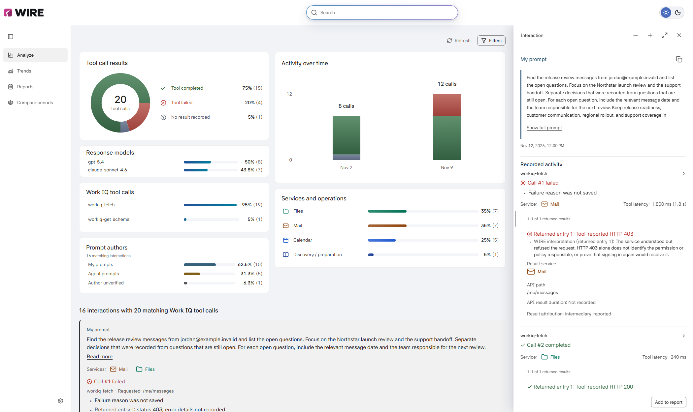
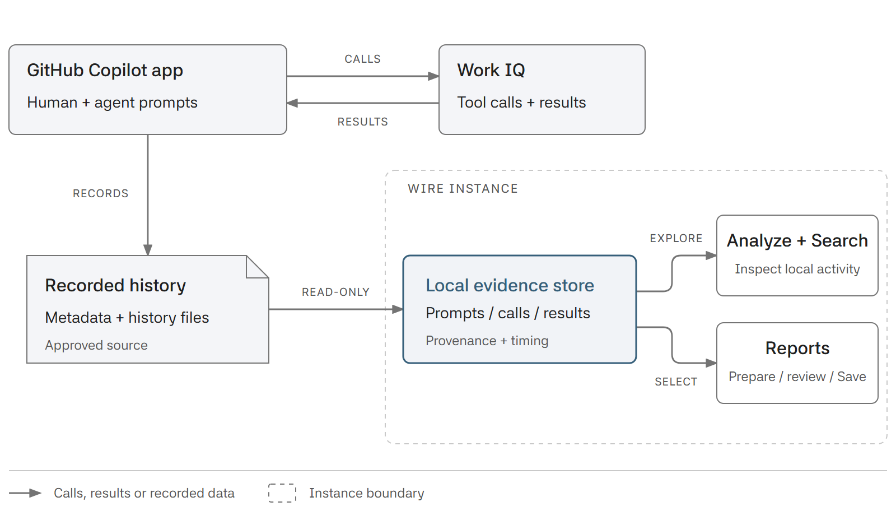

<p align="center">
  <picture>
    <source media="(prefers-color-scheme: dark)" srcset="assets/wire-lockup-dark.svg">
    
  </picture>
</p>

I built WIRE (Work IQ Request Explorer) to understand real Work IQ interactions.
Curated evals are valuable, but real people phrase requests differently,
leave context unstated and change direction. Their agents generate prompts too.

WIRE puts those prompts beside their recorded tool calls and results, so you can
find patterns and failures, improve your agents and build better evaluation cases.

[](docs/images/wire-overview.png)

Search runs on-device without AI or provider calls. Review report text before
saving HTML, PDF, JSON or Markdown.

## How WIRE fits

WIRE reads recorded Work IQ activity from the **GitHub Copilot app** without
rerunning its calls, then keeps local evidence for inspection and reviewed reports.

<a href="docs/images/wire-evidence-flow.png">
  <picture>
    <source media="(max-width: 767px) and (prefers-color-scheme: dark)" srcset="docs/images/wire-evidence-flow-narrow-dark.png">
    <source media="(max-width: 767px)" srcset="docs/images/wire-evidence-flow-narrow.png">
    <source media="(prefers-color-scheme: dark)" srcset="docs/images/wire-evidence-flow-dark.png">
    
  </picture>
</a>

See [Architecture](docs/architecture.md) for the local runtime and storage boundaries.

## Start

You need Node.js 24 or newer and access to this repository.

```sh
git clone https://github.com/likamrat/wire.git
cd wire
npm ci
npm start
```

WIRE runs locally on **port 4000 by default**. Open
[http://127.0.0.1:4000/](http://127.0.0.1:4000/) and keep the terminal running.
You can [choose a different port](docs/development.md#changing-the-local-port).

In **Settings > Connection & updates**, choose **Review source & connect**.
Check the local Copilot paths and history window, then approve collection.
The [first-run guide](docs/user-guide.md#connect-local-history) walks through
these choices. Starting WIRE alone does not approve a source.

Collected activity and saved reports stay in a per-user folder outside the
repository. See [data locations](docs/collection.md#store-ownership) for
Windows, Linux, macOS and WSL defaults and how to choose another folder.
Independent instances can read the same approved Copilot source using distinct
data folders and ports; each store has one writer. Settings and saved reports
are not synchronized. Saving Copilot replies needs separate
approval; review report copies before sharing because local masking can miss
confidential information.

## Comparisons and reports

Compare recorded call outcomes and timings across two periods.

[](docs/images/compare-periods.png)

Open a saved report to read its selected activity, tool and service patterns,
and recorded results.

[](docs/images/saved-report.png)

## Guides

- [Use WIRE](docs/user-guide.md)
- [Create and compare reports](docs/reporting.md)
- [Develop and troubleshoot](docs/development.md)
- [Technical documentation](docs/README.md)

## Contributing

[Open an issue](https://github.com/likamrat/wire/issues) with a reproducible
problem or a proposed improvement. For a change, open a focused pull request
that explains the behavior, updates the relevant guide and includes the checks
you ran. See [Development](docs/development.md#check-a-change) for local checks
and code entry points.

Use invented examples in tests and screenshots. Keep personal histories,
prompts, reports, credentials and local configuration out of issues and commits.
