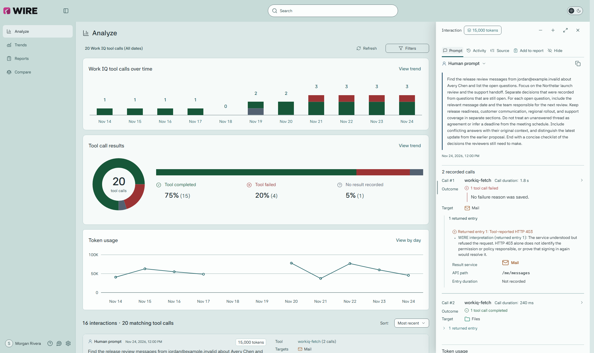
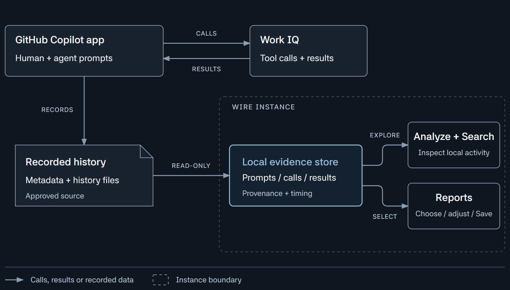
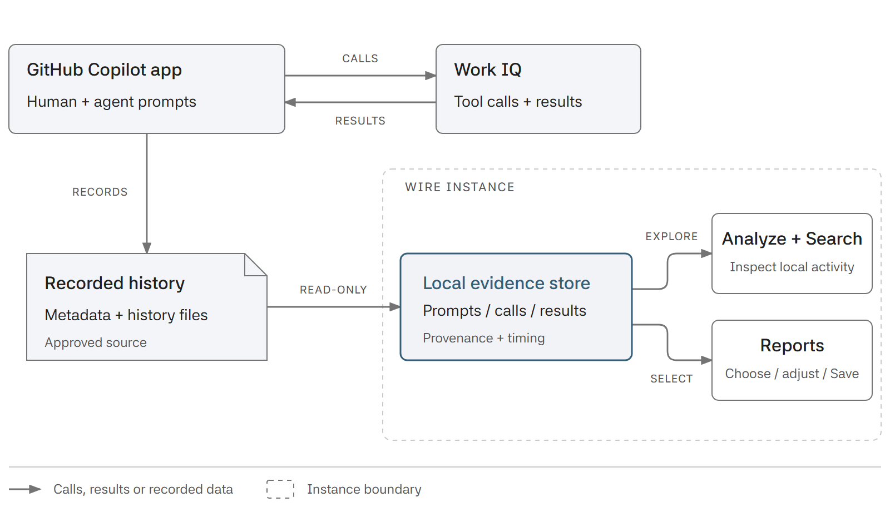
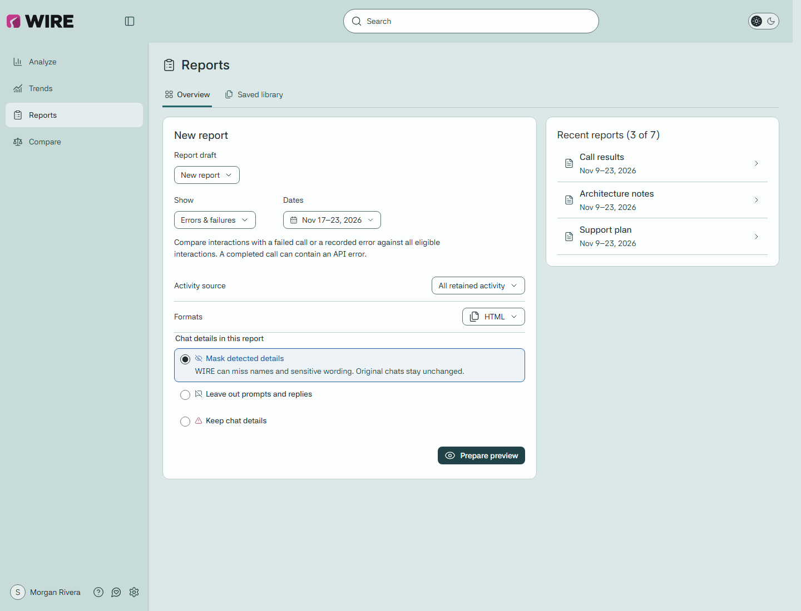
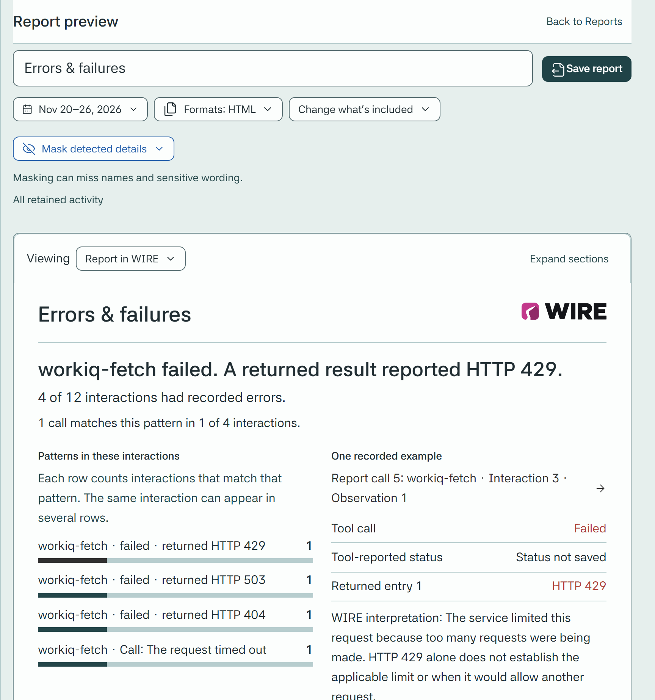
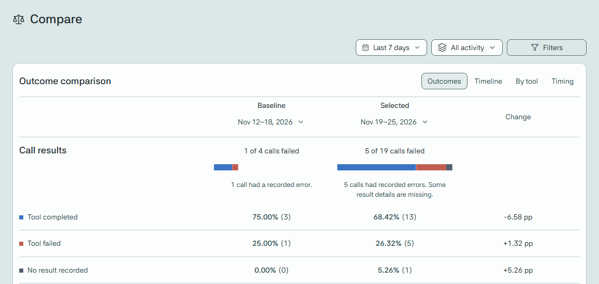

<p align="center">
  <a href="docs/images/wire-readme-logo-dark.svg#gh-dark-mode-only">
    
  </a>
  <a href="docs/images/wire-readme-logo.svg#gh-light-mode-only">
    
  </a>
</p>

# Work IQ Request Explorer

Synthetic evals are essential, but they will always have a blind spot: how people
actually work with AI. People phrase requests differently, bring different context
and take different paths through multi-turn conversations. Those choices shape
both their own prompts and the prompts their agents generate, influencing the
tool calls and results that follow.

WIRE (Work IQ Request Explorer) was built to help you understand that blind spot
in your own work. It puts recorded human and agent-generated prompts beside their
Work IQ calls and results, so you can inspect personal patterns, unexpected
behavior and failures.

Those real interactions can become the basis for better synthetic eval cases.
Product teams and customers building agents on Work IQ APIs and MCP can use
that evidence to test the behaviors people rely on and improve their agents.

[](docs/images/wire-overview.png)

Search runs on-device without AI or provider calls. Reports save locally as
HTML, PDF, JSON or Markdown, with detected personal details hidden by default.

<a id="start"></a>

## Getting started

### Platforms

Run WIRE with Node.js 24 or newer on:

- Windows
- WSL
- Linux
- macOS

Collection also needs accessible, supported GitHub Copilot app history.
See [platform setup](docs/development.md#windows-wsl-and-linux) for source
requirements and running separate instances.

### Coding agent

Copy this prompt into your coding agent:

```text
Set up and run WIRE locally from the main branch of
https://github.com/likamrat/wire.

Follow README.md and docs/development.md for this machine. Check for
Node.js 24+ and a running WIRE instance before installing or starting
anything. Preserve existing work and data.

Use npm ci, npm run build and npm start for a new installation. Open the printed local
URL and verify that WIRE loads. Leave it running and tell me how to
reopen it. Ask me when setup choices need my input. Leave source
approval and reply-saving consent to me in WIRE.
```

<a id="install-and-run"></a>

### Manual setup

```sh
git clone https://github.com/likamrat/wire.git
cd wire
npm ci
npm run build
npm start
```

The default browser address is `localhost:4000`. Keep the terminal running
while you use WIRE.

On Windows or WSL, choose **Update** when offered to restart this installation at the
same address with your settings and reports. **Dismiss** hides that build's
notice; **Settings > General** lets you check or install it later. Older
installs, macOS and standalone Linux use the [same-clone update instructions](docs/development.md#updating-wire).

### Connect your history

Choose **Review and connect**, check the local paths and history window, then
approve collection. **Not now** leaves the prompt in Analyze.
See [Connect local history](docs/user-guide.md#connect-local-history) to connect later.

### Your data

- Activity and reports stay in a [per-user data folder](docs/collection.md#store-ownership)
  outside the repository.
- Independent instances need separate data folders and ports, with their own
  source approval, collection progress and reports.
- Saving Copilot replies needs separate approval. Review report copies before
  sharing; local masking can miss confidential information.

## How WIRE fits

WIRE reads recorded Work IQ activity from the **GitHub Copilot app** without
rerunning its calls, then keeps local evidence for inspection and reports.

<a href="docs/images/wire-evidence-flow-dark.png#gh-dark-mode-only">
  <picture>
    <source media="(max-width: 767px)" srcset="docs/images/wire-evidence-flow-narrow-dark.png">
    
  </picture>
</a>
<a href="docs/images/wire-evidence-flow.png#gh-light-mode-only">
  <picture>
    <source media="(max-width: 767px)" srcset="docs/images/wire-evidence-flow-narrow.png">
    
  </picture>
</a>

See [Architecture](docs/architecture.md) for the local runtime and storage boundaries.

## Trends

Follow changes in daily tool use, errors or timing. Select a day to inspect
the calls behind it, or compare two measures over the same dates.
See [Trends](docs/user-guide.md#trends) for the seven measures and what each counts.

## Reports

In Analyze, choose **Add to report** on an interaction card or in the reader to
[add it to a named draft](docs/reporting.md#keep-interactions-in-a-draft).
You can also start in Reports with a focus such as **Errors & failures**.
[Preview the report](docs/reporting.md) before saving a local copy.

[](docs/reporting.md)

[](docs/reporting.md)

<a id="comparisons"></a>

## Compare

Compare a selected period with a baseline. Open either period's count to see
which calls changed. See [Compare two periods](docs/reporting.md#compare).

[](docs/images/compare-periods.png)

## Guides

- [Use WIRE](docs/user-guide.md)
- [Read Trends and inspect supporting calls](docs/user-guide.md#trends)
- [Create and read reports](docs/reporting.md)
- [Develop and troubleshoot](docs/development.md)
- [Technical documentation](docs/README.md)

## Contributing

[Report a bug or suggest an improvement](https://github.com/likamrat/wire/issues),
or see [Contributing](CONTRIBUTING.md) to submit a change.

## Security

Follow the [security reporting guide](SECURITY.md) for suspected vulnerabilities.

## License

WIRE is licensed under the [MIT License](LICENSE). Third-party components
retain their own licenses and notices.
