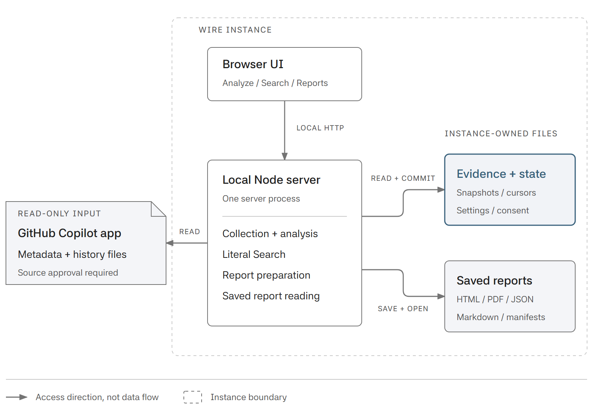

# Architecture

WIRE reads recorded Work IQ activity from the **GitHub Copilot app**. It does
not rerun those calls or collect from Microsoft Copilot, Microsoft 365 Chat
or Cowork. The [README overview](../README.md#how-wire-fits) shows how that
history becomes evidence for inspection and reports.

## Local runtime

The browser talks to one local Node server. Collection, analysis, literal
Search and report preparation are modules in that server, not independently
deployed services. Arrows point from each component to the resource it accesses.

<a href="images/wire-runtime.png">
  <picture>
    <source media="(max-width: 767px) and (prefers-color-scheme: dark)" srcset="images/wire-runtime-narrow-dark.png">
    <source media="(max-width: 767px)" srcset="images/wire-runtime-narrow.png">
    <source media="(prefers-color-scheme: dark)" srcset="images/wire-runtime-dark.png">
    
  </picture>
</a>

The GitHub Copilot app's metadata database (SQLite) and history files are
**read-only inputs**.
WIRE's data directory holds its own content-addressed evidence snapshots,
state, collection cursors, settings, consent and saved report files. Each
directory has one writer. Concurrent instances need distinct data directories
and reachable ports; they do not share writable SQLite or synchronize reports.
See [store ownership](collection.md#store-ownership).

When WSL reads Windows-owned live metadata, a bounded, short-lived Windows
Node process runs the same fixed read-only metadata projection. History files
still use the bounded file reader. This helper is not a second WIRE server
or a persistent bridge; see [source reading](collection.md#source-mapping-and-bounded-reads).

## Evidence boundaries

- **Recorded, not inferred.** Prompts, authors, calls, results and timing retain
  their qualified source associations. Missing, partial and unknown evidence
  are not zero or failure. WIRE does not judge answer quality or generate
  evaluations. See [evidence and membership](report-contract.md#evidence-and-membership).
- **Search stays on-device.** Deterministic literal matching reads authorized
  retained content and verified saved files, without AI or provider queries.
  Its index is process-private, not a new collection source. See
  [Search](live-search.md) and the [authorized corpus](search-corpus.md).
- **Review is separate from Save.** Report preparation freezes the selected
  facts and file bytes. Disclosure approval does not save them; Save is a
  separate action. Later collection does not rewrite saved reports. See
  [the report contract](report-contract.md#preparation-disclosure-and-save).

Source approval, withdrawal and uncertain operations follow
[runtime access](runtime-access.md). For implementation entry points, use
[the existing code map](development.md#find-the-owning-code).

## Diagram sources

The PNGs come from editable, self-contained HTML with inline SVG:
[evidence flow](diagrams/wire-evidence-flow.html) and
[local runtime](diagrams/wire-runtime.html). Each source includes light/dark
and narrow layouts, bundled Asta Sans with its license, and capture instructions.
Edit those sources and regenerate the PNGs together.
