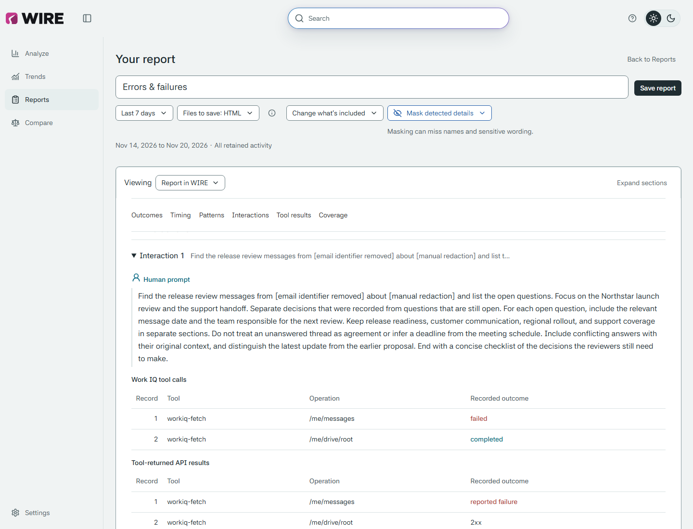
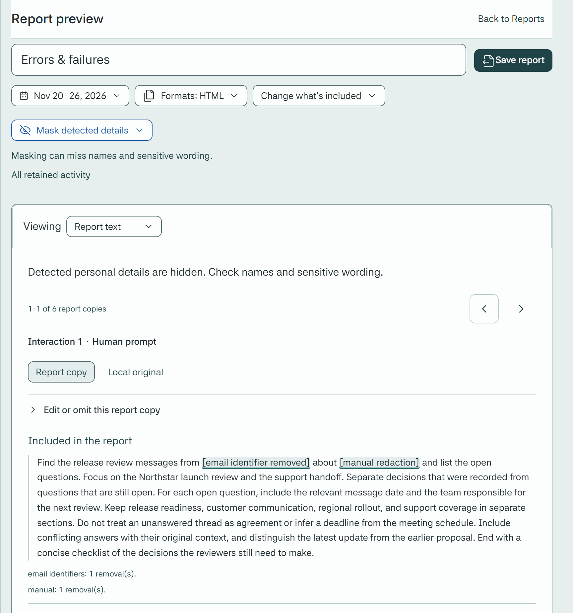
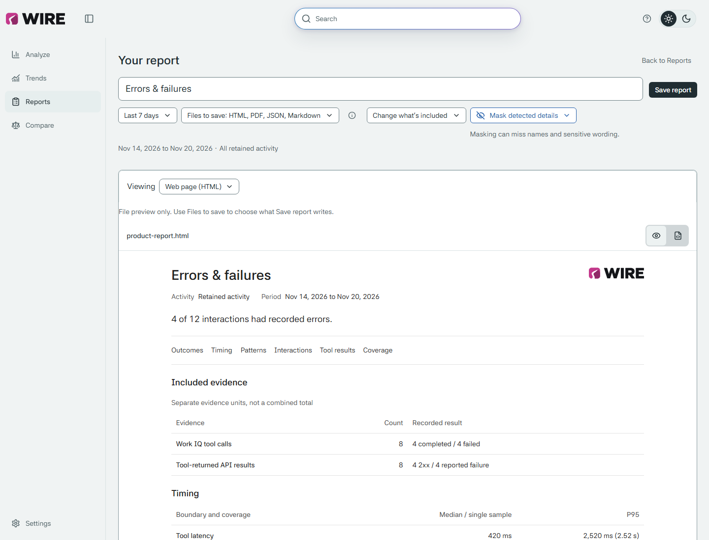
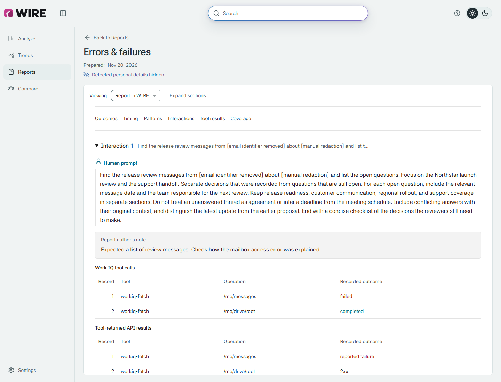
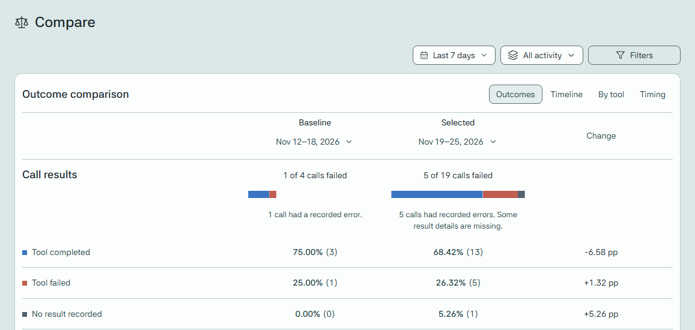

# Create and read reports

A report preserves selected interactions and their recorded Work IQ calls.
Use it to explain repeated errors, operations and working patterns. The recorded
examples can also serve as a starting point for eval cases. WIRE does not
generate evals or rate answer quality.

Go to [report choices](#open-a-report), [text and privacy options](#read-and-adjust),
[saving and reopening](#save-and-reopen) or [comparisons](#compare).
Contributors changing report behavior should also read the
[membership and frozen-output contract](report-contract.md).

## Open a report

Open **Reports** and choose a recent name in **Overview**, or use **Saved library**
to search the library. Under **New report**, choose which chat details to
include, then check **Report focus**, **Activity period**, **Activity** and
**Formats**.
The default, **Mask detected details**, keeps the wording with local masking.
You can leave out prompts and replies or keep chat details instead.
This choice applies to the readable report and its saved files.
**Prepare preview** opens a right-side drawer without writing files. Check the
report there, then choose **Save report** to write the selected files locally.
When the activity includes retained Microsoft conversations, the ordinary
report uses **All activity** and **All retained dates** for that scope. It
does not apply GitHub interaction presets or pretend an undated conversation
belongs to a report date range. For two dated Microsoft periods, start in
**Compare**, choose the periods and select **Create report**.
If recorded activity changes while you read, a note in the drawer tells you
that the preview still contains the activity it was prepared with.
If you kept chat details, the confirmation names those formats. Nothing is sent.

| Report | Includes |
| --- | --- |
| All activity | Recorded prompts, Work IQ calls and results. Eligible interactions with an unverified author remain included. |
| Errors & failures | Interactions with any recorded failed call or explicit application/API error, including mixed results. |
| Completed calls | Interactions with at least one recorded call, all calls completed and no recorded errors. This does not establish task success. |
| Human prompts | Interactions whose originating prompt is recorded as user-authored. |
| Agent prompts | Interactions whose originating prompt is recorded as agent-authored. |

If a returned status and its diagnostic disagree, both remain visible. Recorded
error evidence on either side qualifies for **Errors & failures**; a disagreement
without an error does not. The tool's recorded completion stays unchanged.

New reports start with **Last 7 days** (including today in the display time zone)
and HTML unless you choose a different period or file formats in **Settings >
Reports**. You can change either in the draft. Opening a saved report or
resuming a draft does not apply new defaults to it. **Last 14 days**, **Last
30 days** and **Custom dates** are also available.
Custom dates opens the calendar directly; Cancel leaves the accepted dates
unchanged. Undated activity is not assigned to a dated period.

A fresh report is independent of Analyze and Trends filters. After
[inspecting a dated Trends point](user-guide.md#inspect-a-change), choose the
report's period and activity explicitly. To narrow an open report, use
**Change what's included > Change activity selection**:

| Scope | Includes |
| --- | --- |
| Selected interactions | Your deliberate picks, including selections hidden by later filters or another page. |
| Current Analyze view | Every matching interaction across pages, with its complete eligible evidence, not just the individual calls matching a chart. |
| All collected activity | Retained reportable activity independently of Analyze dates, filters, Search and paging. It does not collect new history or include complete original chat transcripts. |

From the outline, choose **Activity**, select the scope and use **Use activity**
to return without preparing. From an open report use **Show report** to update it.
The activity picker keeps its actions visible while its
contents scroll together, without a second scroll area inside the interaction list.
Failure summaries keep the recorded tool name; open an interaction to read its
exact calls and returned results. **Close** leaves your selection intact; it does not save a report.
On Analyze, use the report icon beside the call count or **Add to report**
beside **Source** in the reader. Pick a local report draft, search by name, or
choose **New draft**. To remove the interaction from just one draft, reopen
the picker and choose that draft's **Remove** row. Other drafts and the
recorded interaction are unchanged.

In **Reports**, choose the name under **Report draft**, then **Prepare preview**.
Quick additions keep their membership across reloads, not a copy of the chat.
They never write an export or change an already prepared or saved report.

**Back to Reports** returns to the choices and saved list. It keeps an unfinished
copy in memory. Use **Resume preview** with the same focus and unchanged dates to
return to that copy, including its name and notes. Preparing another focus replaces the
unfinished copy. Reports entered from Analyze keep their contextual return.

**Selected interactions** initially includes your picks across all dates.
Changing report dates does not remove those picks. If you start from
**Current Analyze view**, changing the report dates replaces only the date
restriction. Other applicable filters and authorized Search membership stay
in place; Analyze itself does not change.

If WIRE later corrects who sent a prompt, reports already prepared or saved
stay unchanged. Prepare a new report to use the corrected author.

## Read the findings

New focused reports put a finding, its population and one recorded example
together in preview, Brief and the saved document. Compare the directly labeled
pattern rows by **interactions**, not calls: an interaction can match several
rows, so the bars do not add to a total. Choose a pattern for its members, or
open the example call directly. A tool's completion, a tool-reported status
and the status of a particular returned entry answer different questions.
For example, a completed batch can have HTTP 200 on one entry and 403 on
another. A quoted diagnostic belongs to its named observation and entry.
Use the named section disclosures in Full report without leaving your place.

In **Saved library**, open a report by name. Supported focused reports open in
**Brief** with the leading recorded pattern, its population and a saved error
message when available. Choose the matching interactions, then a Work IQ call
to read its completion and returned API entries. **Back** returns to the same
row. **Coverage** holds counts, timing and preparation details.

Choose **Viewing > Full report** for the continuous saved reading or a file
format to inspect its original. Reports without supported frozen relationships
keep their existing reader. Brief does not change saved files or fill gaps from
current activity.

New reports lead with the included activity, separate call and returned-entry
outcomes, and timing coverage before the patterns and individual interactions.
Read interaction, tool-call and returned-API counts separately.
Then read the tool and service patterns, failures and timings. A completed
tool call does not establish a correct answer, and a returned API error does
not automatically explain its parent call's outcome. Service associations
can overlap.

**Partial completion** means the retained call explicitly has a partial tool
outcome. It does not say which part completed. It is not inferred from mixed
API statuses, HTTP 206 (Partial Content), missing timing or partially retained
response text. Open the call for its recorded details and provenance gaps.

Timing keeps its recorded boundary and measured population. Missing model
names, timing or recorded application results remain unavailable, not zero.
Examples connect permitted prompt copies with recorded calls; they are not
generated explanations of intent or task success.

**Tool results** lists every call included in the report, including calls with
no retained diagnostic. **WIRE interpretation** explains supported conditions
and evidence limits beside those results. It is separate from original error
text and report-author notes, and does not recommend next steps.

## Read and adjust

The report shows its period, scope and recorded patterns. An error report
can say, for example, that 4 of 12 interactions contained a recorded error.
Only those 4 cases contribute prompt or diagnostic copies. The other
interactions supply the frozen reference count, not additional disclosed text.

Use the section links to jump to patterns, interactions, timing or coverage.
Open a section or interaction to read its full evidence. **Expand sections**
opens everything; collapsing changes only the view, not the report's contents.
The reader keeps its navigation visible while you scroll. **Coverage**
holds the preparation and time-zone metadata.

Every included interaction remains accessible. Open it, then **Add a note or edit this
example** lets you explain what you expected, change a prompt copy or omit it.
Notes are the report author's context; they do not change recorded outcomes or
metrics. Select **Update note** or **Update prompt copy** to apply an edit.
The interaction stays open so you can check the changed copy where you were reading.

The toolbar changes the report name, **Report text** and files to save.
The text control stays blue for masking, gray when prompts and replies are
left out, and red with a warning icon when chat details are kept. Labels and
icons identify each state without relying on color. Masking can miss names
or sensitive wording.

**Change what's included** holds author/service/outcome choices and optional
linked context. **Authors in report** keeps your choices as a draft until
**Apply**; **Cancel** leaves the accepted authors unchanged.
**Viewing > Report text** opens optional text inspection.
It shows one **Report copy** at a time, with its interaction and recorded author.
**Local original** switches to the retained source; it is not an extra copy
included in the report. **Edit or omit this report copy**, then **Update report
copy**, changes only that report copy. The original stays unchanged.
Return to **Report** or a file through **Viewing**.

To hide a name WIRE missed, open the **Report text** control in the toolbar,
expand **Hide specific words**, and enter one name or phrase per line.
Adding `Avery Chen`, for example,
hides that text throughout the report copies, including notes. Matching ignores
case; other spellings stay. This optional step does not change original chats.

| Choice | Effect |
| --- | --- |
| Leave out prompts and replies | Omits originating request, follow-up, tool-question and linked reply text. Notes and selected error messages remain, with detected personal details hidden. |
| Mask detected details | Uses retained wording with local masking. This is the default; WIRE may miss names or sensitive context. |
| Keep chat details | Retains recorded wording in the report and saved files. Detected credentials are still removed. |
| Include linked requests and replies | Adds available, authorized context up to one linked request before and after each included interaction. It is not the whole chat or a reply-saving permission. |
| Include error messages from the calls | Adds already-retained error details, always masked. Error reports start with it on. It does not add raw response bodies or unrelated source descriptions. |

Masking, edits and omissions still control the diagnostic copies. A fixed WIRE
interpretation can remain when you leave out error-message text; it does not
restore the omitted wording or read prompts, replies or arguments.

**Formats** lets you select HTML, PDF, Markdown and JSON in any combination.
**Viewing** changes only what you are reading: **Report** is the readable page,
while a file choice shows that actual format in its own reading pane. Text
inspection stays out of the file view. PDF has page controls, JSON has
a field tree, and HTML and Markdown offer Preview/Source. Switching views does
not prepare new activity or download anything. **Manifest file** shows the
report's coverage, disclosure choices and file hashes; it accompanies the
selected output files.
Hover or focus a viewer icon to see **Preview**, **Tree** or **Source**.
PDF pages keep their fixed layout; use zoom when **Fit width** makes text too small.

PDF generation needs the
[optional local browser setup](development.md#pdf-and-browser-tools); the other
formats do not. Detected personal details in report names are hidden in every
text mode. Changing the name, text, notes or formats regenerates prepared
files while keeping the original interaction cohort. Your selected file and
Preview/Source mode stay selected during these updates and after changing the
report period or call filters. Removing that file
from **Formats** returns to **Report**. Save is unavailable until the update finishes.

Additional masking terms, edits and omissions affect report copies only.
Missing or partial text stays qualified; editing does not recover source text.
Changing Report text keeps edits and omissions for included copies. Leaving out
prompts also turns off linked context; edits to that excluded context are retired.
Turning linked context on or off preserves edits and omissions for ordinary copies
that remain included. Only copies removed with the linked context lose their edits.
If the same recorded message appears as both an originating prompt and a follow-up,
it shares one copy choice with context enabled. Conflicting choices are refused,
not silently replaced.
Changing choices in the outline does not prepare a report until you select **Prepare preview**.
Reopening the same unfinished report keeps its frozen activity.

## Save and reopen

Use **Save report**. The default masked report saves without another step.
If you chose **Keep chat details**, a warning names the prompts, replies, notes
and sensitive information that may be included:

| Choice | Effect |
| --- | --- |
| Mask detected details and save | Saves a new copy with masking. Masking can miss names and sensitive wording. |
| Save with chat details | Confirms this particular local save with chat details kept. |
| Go back | Writes nothing. |

The save receipt records your choice to save locally, not a claim that you
reviewed every copy. Older reports keep the review confirmation recorded
when they were saved.

Choose **Open saved report** to read it inside WIRE. To find it later, open
**Reports** and select its name beside the document icon. Supported JSON-only
reports also open as readable pages, using their verified saved facts. No download is needed.
**Files** opens a specific saved format. **Report text** shows the saved text
treatment beside its icon; missing older metadata stays unrecorded.
**Inspect details** on the row shows its other
metadata. In the reader, choose **Report** to return from a file preview, or
**Download** to retrieve that file's original bytes.

**Prepared** is when the report was created. **Report period** is its saved date
selection; **All retained dates** means no date restriction. Older saved-list
entries may not include a period, even when dates appear inside the report.
WIRE does not replace a missing period with the preparation time or current filters.

Older unverified reports keep their warning before **View report**. Missing,
altered or unsupported saved content remains unavailable; WIRE does not rebuild
it from current activity or silently open another format.

Saved reports retain their frozen facts, text choices and time context.
Later collection, browsing filters or screen-theme changes do not rewrite them.
**Report** selects a readable WIRE logo for the report's background. Original
file views and downloads keep their saved artwork, even if an older logo has poor contrast.
Reopening an older report does not add newer interpretations. New reports need a
compatible WIRE reader; an older version may refuse to open them.
In **Saved library**, search for a report name, its displayed period, a start or end
date (such as `2026-11-07`), a file format or its text treatment. This searches
saved metadata. Use global Search to find text inside supported files.
**Back to Reports** restores the list's search, order, page
and reading position. Page controls are below the saved rows.
Use Previous/Next, or enter a page and choose **Go to page**. Enter submits the
same page choice; an out-of-range number does not change the page.

If Save is unconfirmed, use **Check save status** rather than Save again.
The action appears beside the warning and checks the original save receipt.
A missing receipt is not proof that nothing was written. Review files before
sharing outside WIRE: local saving is not permission to publish, and pattern
masking cannot recognize every confidential detail.

## Compare

Open **Compare** in the left sidebar. It starts with all eligible
retained activity, independently of Analyze filters. The
first result compares the last seven complete days, ending yesterday, with
the preceding seven days in the display time zone. Set another starting period
under **Settings > Compare**.

**Last 14 days** and **Last 30 days** use the same complete-day rule.
**Custom dates** opens both calendars; each range includes its start and end
days. **Cancel** leaves the accepted comparison unchanged. Unequal or overlapping
ranges are allowed and remain labeled.

For GitHub Copilot calls, Analyze, Compare and Trends use the recorded call
start in the display time zone. If the start is missing or has no time zone,
the call remains in **All dates** but does not belong to either period. A zero
in a period is not proof that history collection was complete.

The compact activity choice offers All activity, Errors & failures, Completed
calls, Human prompts and Agent prompts. **More options** retains source, tool,
service, category, author, outcome, project, chat, evidence-layer and collection
choices, plus path, service-intersection and timing-interval controls. Choices
apply directly. **Use Analyze view** deliberately imports Analyze's non-date
filters and authorized Search selection; it replaces only the dates.
Choosing Human prompts or Agent prompts keeps an existing error/completion focus;
the menu names the combined choice. All activity clears those menu choices.

Switch **Outcomes**, **Timeline**, **By tool** or **Timing** inside the chart.
These views keep the same accepted pair. Hover or focus a mark for its exact
values; select it to inspect supporting records. **View calls** opens the
paired activity, while **View numbers** shows the values for the current chart.
Missing results and timing remain unavailable. Different period lengths,
overlap and incomplete evidence can limit what a change means.
Outcomes and By tool use a shared **Call count** scale, not percentage-scaled
bars. Percentage-first values use each period's own denominator. Selecting a
mark narrows both the exact rows and their interaction/service captions.

**Create report** freezes the accepted pair and opens the existing report
experience with the same formats, masking, optional notes and local Save.
**Back to comparison** restores its dates, choices and reading position while
access remains valid.

To read an existing report, open **Reports > Saved library** and choose its
name. Previously saved comparison files open there too. They retain their
original contents even if a source report is later deleted.

## Remove a saved copy

Open **Saved library** and choose **Delete report** or
**Delete saved comparison** on its row.
Its confirmation removes that managed bundle, not original source
activity or external downloads. **Saved-report options > Delete all saved
reports** previews all report bundles across pages and search, not just visible
rows; saved comparisons remain.

Deleting collected activity is a separate Settings operation and does not
remove independently saved reports. For an interrupted deletion, read its
original result rather than confirming a new operation.
