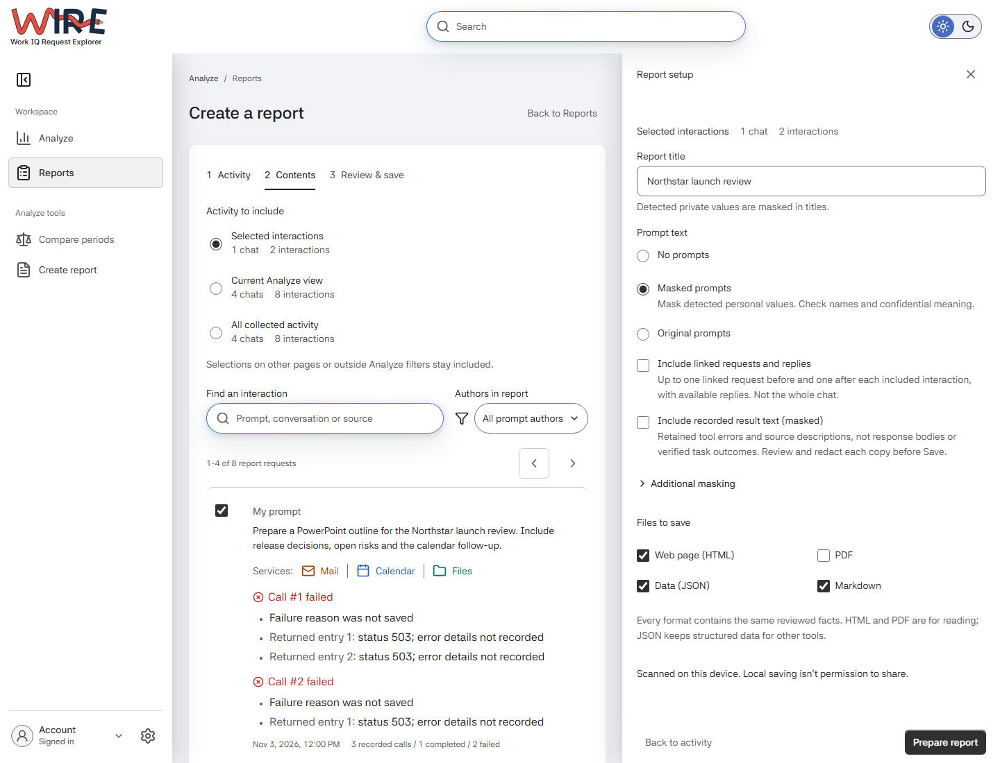
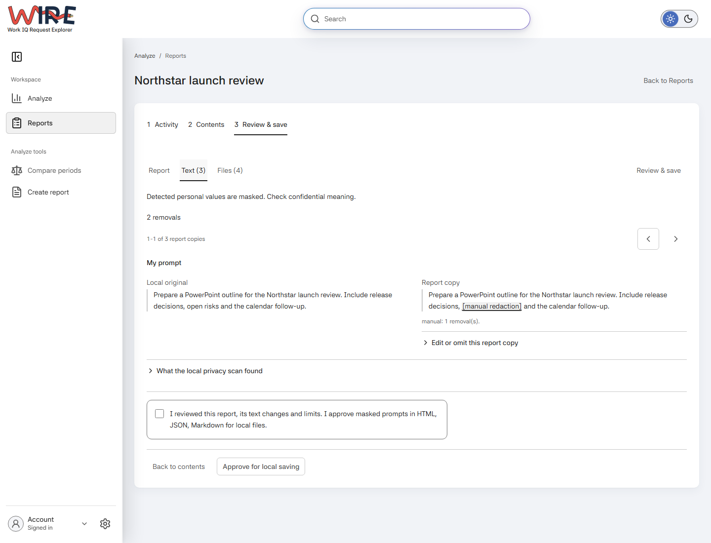

# Create and compare reports

A report preserves the evidence you chose, as you reviewed it. Use it to
explain recorded tool and service patterns, failures and timings. It does not
rate answer quality.

This guide covers the released GitHub Copilot experience. For schemas,
membership, privacy and historical formats, see the [report contract](report-contract.md).

## Choose the activity

Open **Reports > Create a report**. New drafts start with an empty selection.
To report a few interactions, select their checkboxes in the activity picker.
You can open an interaction to inspect it without selecting it.

| Scope | Includes |
| --- | --- |
| Selected interactions | Your deliberate picks, including selections hidden by later filters or another page. |
| Current Analyze view | Every matching interaction across pages, with its complete eligible evidence, not just the individual calls matching a chart. |
| All collected activity | Retained reportable activity independently of Analyze dates, filters, Search and paging. It does not collect new history or include complete original chat transcripts. |

Check the chat and interaction counts. **Authors in report** changes which
whole interactions are included. My prompts plus Agent prompts excludes
unverified authors; All includes them. Changing prompt-text mode later does
not change membership.

For a report on a particular week or service, first set those filters in
**Analyze**, then choose **Current Analyze view** in the report picker.
Use **Selected interactions** instead when you want individual examples rather
than everything matching those filters.

## Choose the contents

Select **Continue to contents**. The report setup opens beside the picker.
Give it a title you will recognize in the saved library, such as
`Northstar launch review`, then choose its text and formats.

| Choice | Effect |
| --- | --- |
| No prompts | Omits originating request, follow-up and tool-question text. |
| Masked prompts | Uses retained wording with local masking. Review names and confidential meaning; this is the default. |
| Original prompts | Includes recorded wording in local files. Detected credentials are still removed. |
| Include linked requests and replies | Adds available, authorized context up to one linked request before and after each included interaction. It is not the whole chat or a reply-saving permission. |
| Include recorded result text (masked) | Adds retained tool errors and supported source descriptions, not response bodies. This starts off and remains masked in every prompt mode. |

Choose HTML or PDF for reading, JSON for complete structured records, or Markdown
for portable text. You can select more than one. PDF generation needs the
[optional local browser setup](development.md#pdf-and-browser-tools); the other
formats do not. Titles are always masked metadata.

## Prepare and inspect

Choose **Prepare report**. Read the actual document in **Report**, inspect
originals and copies in **Text**, and check the prepared formats in **Files**.
No saved bundle exists yet.

*An additional masking term removes "open risks" from the report copy.
The original retained text stays unchanged.*

If a copy includes a name or phrase you do not want to share, edit or omit
that copy, or return to Contents to add exact masking terms.
Use **Rebuild preview** and review again after changes. Partial, unavailable
and credential-excluded text stays qualified; editing cannot recover missing
source text or bypass credential removal.

## Approve, save and reopen

After checking the copies, select the disclosure checkbox and **Approve for
local saving**. Then use the separate **Save report** action. Approval alone
does not save.

Choose **Open saved report** to read the saved file. To find it later, open
**Reports** and choose the report in the library. The file selector changes
formats; **Download** retrieves the original saved file.

Saved reports retain their reviewed facts, text choices and time context.
Later collection, browsing filters or screen-theme changes do not rewrite them.
In the Reports library, search finds saved metadata; global Search can also
find supported saved-file content.

If Save is unconfirmed, use **Check save status** rather than Save again.
A missing receipt is not proof that nothing was written. Review files before
sharing outside WIRE: local saving is not permission to publish, and pattern
masking cannot recognize every confidential detail.

## Read the findings

Start with which activity the report includes and which facts were available.
Read interaction, tool-call and returned-API counts separately.
Then read the tool and service patterns, failures and timings. A completed
tool call does not establish a correct answer, and a returned API error does
not automatically explain its parent call's outcome. Service associations
can overlap.

Timing keeps its recorded boundary and measured population. Missing model
names, timing or recorded application results remain unavailable, not zero.
Examples connect permitted prompt copies with recorded calls; they are not
generated explanations of intent or task success.

## Compare

Use **Analyze > Compare periods** for two retained date ranges without making
reports first. Choose each range, keep the relevant shared filters, then
explicitly compare. Dates include both selected days in the display time zone.
**Create comparison report** carries the accepted pair into the same
Contents, review and separate Save workflow.

Different period lengths or incomplete evidence can limit what a change means.

For existing reports, open **Reports > Compare saved reports**, choose
**Earlier report** and **Later report**, then **Compare reports**. This uses
their frozen facts, not current history. Different definitions, missing facts
or incompatible identities can prevent a comparison.

To keep that comparison, choose formats and **Prepare comparison copy**,
review and approve it, then separately **Save comparison**. Its frozen copy
can remain readable after an input report is deleted.

## Remove a saved copy

**Delete report** or **Delete saved comparison** removes that managed bundle
after its own confirmation, not original source activity or external downloads.
**Delete all saved reports** previews all report bundles across pages and search,
not just visible rows; saved comparisons remain.

Deleting collected activity is a separate Settings operation and does not
remove independently saved reports. For an interrupted deletion, read its
original result rather than confirming a new operation.
