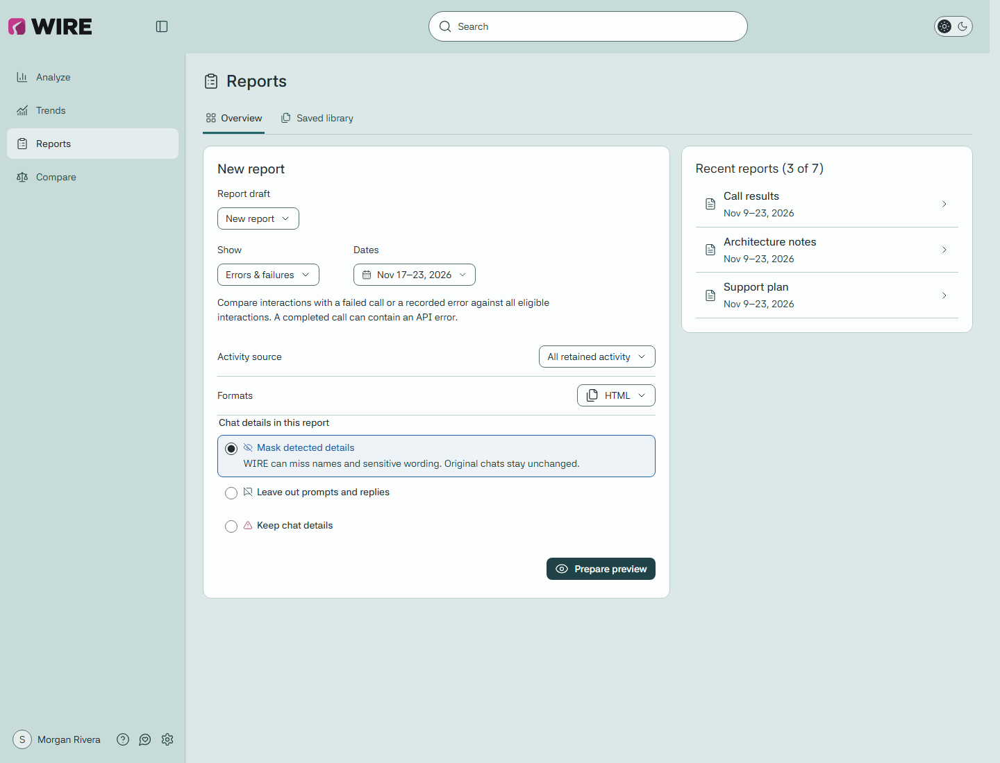
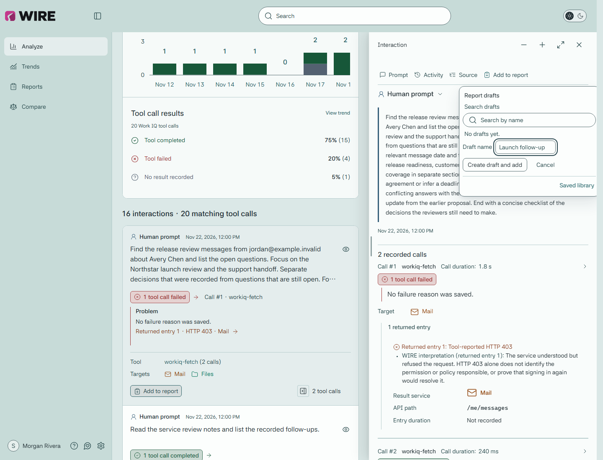
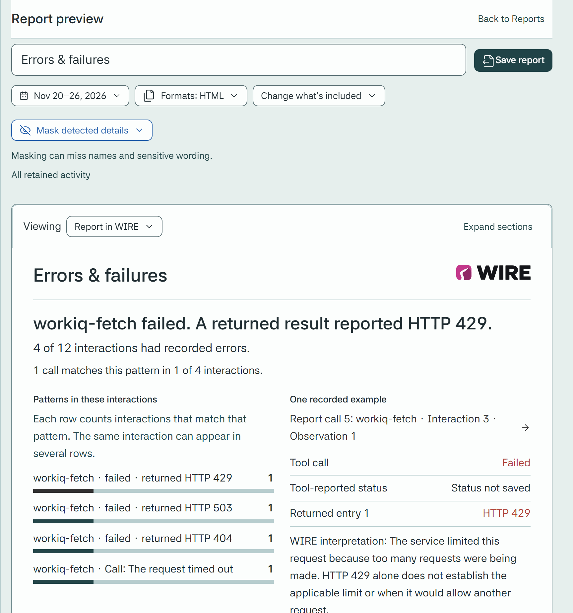
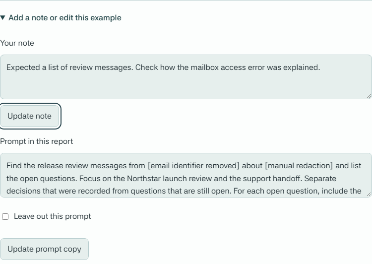
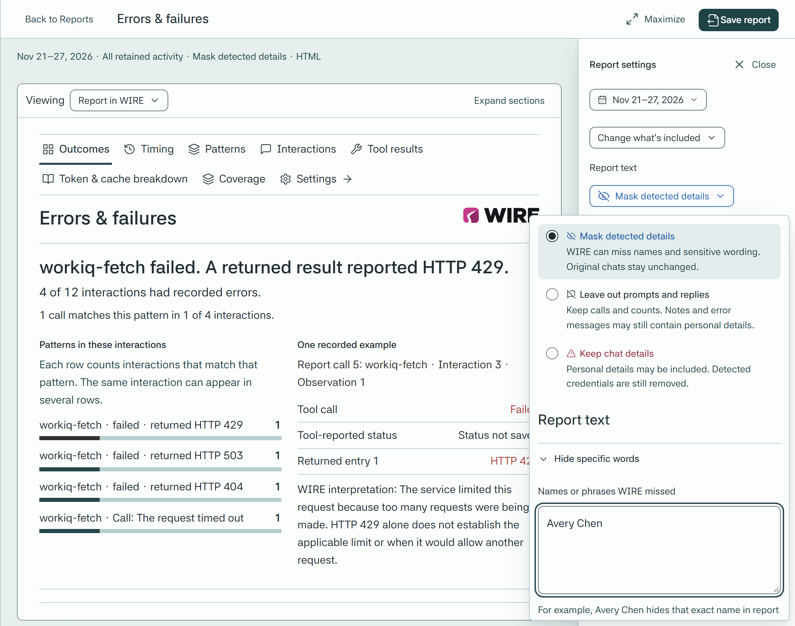
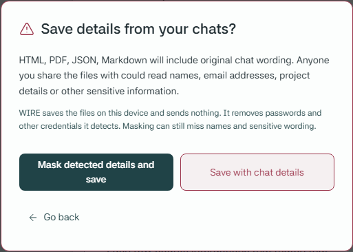

# Create and read reports

A report preserves selected interactions and their recorded Work IQ calls.
Use it to explain repeated errors, operations and working patterns. The recorded
examples can also serve as a starting point for eval cases. WIRE does not
generate evals or rate answer quality.

**Contents**

- [Open a report](#open-a-report): [report choices](#report-choices),
  [dates and activity](#dates-and-activity), [named drafts](#keep-interactions-in-a-draft)
- [Read the findings](#read-the-findings)
- [Read and adjust](#read-and-adjust): [usage and tokens](#usage-and-tokens),
  [notes and copies](#notes-and-copies), [report text and privacy](#report-text-and-privacy),
  [formats and viewing](#formats-and-viewing)
- [Save and reopen](#save-and-reopen): [open a saved report](#open-a-saved-report),
  [what it keeps](#what-a-saved-report-keeps), [find a saved report](#find-a-saved-report)
- [Compare](#compare): [periods](#choose-the-periods), [activity](#choose-the-activity),
  [read the changes](#read-the-changes), [token usage](#token-usage),
  [report on a comparison](#report-on-a-comparison)
- [Remove a saved copy](#remove-a-saved-copy)

Contributors changing report behavior should also read the
[membership and frozen-output contract](report-contract.md).

## Open a report

To find out which calls failed, open **Reports**. Under **New report**, check
the dates, activity source and text choice, then select **Errors & failures**.
Read the finding and open an example in the preview. No files are written
until you choose **Save report**.

For a different starting point:

- **Custom report** lets you set **Show**, **Dates**, **Usage question**,
  **Activity source** and **Formats** before choosing **Prepare preview**.
- **Drafts** opens a [named selection](#keep-interactions-in-a-draft).
- A recent report opens its saved copy. Use **Saved library** to find older reports.

In the preview, you can still change the dates, included activity, text and
formats. If new activity arrives, a note tells you the preview still uses the
original selection. **Mask detected details** is the default for both the
readable report and its files. You can leave out prompts and replies or keep
chat details; [check the text](#report-text-and-privacy) before saving.
If you keep chat details, Save asks you to confirm the named formats. Files
are saved locally.

### Report choices

The configured dates, file formats and text choice apply unless you change them.
Only **Custom report** opens setup rather than preparing immediately.

| Report | Includes |
| --- | --- |
| All activity | Recorded prompts, Work IQ calls and results. Eligible interactions with an unverified author remain included. |
| Errors & failures | Interactions with any recorded failed call or explicit application/API error, including mixed results. |
| Token usage | The largest recorded token contributors, author breakdown and measurement coverage, followed by token/cache counts and linked interactions. Other report sections remain available. |
| Completed calls | Interactions with at least one recorded call, all calls completed and no recorded errors. This does not establish task success. |
| Human prompts | Interactions whose originating prompt is recorded as user-authored. |
| Agent prompts | Interactions whose originating prompt is recorded as agent-authored. |

If a returned status and its diagnostic disagree, both remain visible. Recorded
error evidence on either side qualifies for **Errors & failures**; a disagreement
without an error does not. The tool's recorded completion stays unchanged.

### Dates and activity

New reports start with **Last 7 days** (including today in the display time
zone) and HTML, unless you chose a different period or formats in **Settings >
Reports**. You can change either in the draft.

- **Last 14 days**, **Last 30 days** and **Custom dates** are also available.
- Custom dates opens the calendar directly. Cancel leaves the accepted dates
  unchanged.
- Undated activity isn't assigned to a dated period.
- Opening a saved report or resuming a draft doesn't apply new defaults to it.

A fresh report is independent of Analyze and Trends filters. After
[inspecting a dated Trends point](user-guide.md#inspect-a-change), choose the
report's period and activity explicitly. To narrow an open report, use
**Change what's included > Change activity selection**:

| Scope | Includes |
| --- | --- |
| Selected interactions | Your deliberate picks, including selections hidden by later filters or another page. |
| Current Analyze view | Every matching interaction across pages, with its complete eligible evidence, not just the individual calls matching a chart. |
| All collected activity | Retained reportable activity independently of Analyze dates, filters, Search and paging. It does not collect new history or include complete original chat transcripts. |

- From the outline, open **Activity source**, select the scope and choose
  **Use activity** to return without preparing.
- From an open report, use **Show report** to update it.
- The activity picker keeps its actions visible while its contents scroll
  together, without a second scroll area inside the interaction list.
- **Close** leaves your selection intact. It doesn't save a report.

Failure summaries keep the recorded tool name. Open an interaction to read its
exact calls and returned results.

### Keep interactions in a draft

1. In Analyze, choose **Add to report** on the interaction card or in its reader.
2. Pick a draft by name, using **Search drafts** if needed. For a new draft,
   choose **New draft**, enter a name, then choose **Create draft and add**.
3. Check the draft name on the card. To continue in Reports, choose **Open
   draft** in the confirmation. Nothing is prepared or saved, and unfinished
   work in another tab stays there.

To remove an interaction from one draft, reopen the picker and choose that
draft's **Remove** row. Other drafts and the recorded interaction are unchanged.

In **Reports**, choose the name in **Drafts**, then **Prepare preview**.
The narrow layout also has a **Drafts** shortcut beside **New report**.
Quick additions keep their membership across reloads, not a copy of the chat.
They never write an export or change an already prepared or saved report.

To delete a draft, open its name in **Drafts**, choose **Delete draft**,
check the name and confirm. In Analyze, a card that belonged only to that
draft returns to **Add to report**. Other memberships, the activity itself
and saved files stay intact. If the response is lost, WIRE checks the draft
list. If it can't read the list either, reload Reports to see whether the
draft is still there before taking another action.

**Back to Reports** returns to the choices and saved list. It keeps an unfinished
copy in memory. Use **Resume preview** with the same focus and unchanged dates to
return to that copy, including its name and notes. Preparing another focus replaces the
unfinished copy. Reports entered from Analyze keep their contextual return.

**Selected interactions** initially includes your picks across all dates.
Changing report dates does not remove those picks. If you start from
**Current Analyze view**, changing the report dates replaces only the date
restriction. Other applicable filters and authorized Search membership stay
in place; Analyze itself does not change.

If WIRE later corrects who sent a prompt, reports already prepared or saved
stay unchanged. Prepare a new report to use the corrected author.

## Read the findings

New focused reports put a finding, its population and one recorded example
together in the preview, Brief and the saved document.

- Compare the labeled pattern rows by **interactions**, not calls. An
  interaction can match several rows, so the bars don't add up to a total.
- Choose a pattern for its members, or open the example call directly.
- Use the named section disclosures in Full report without leaving your place.

A tool's completion, a tool-reported status and the status of one returned
entry answer different questions. For example, a completed batch can have HTTP
200 on one entry and 403 on another. A quoted diagnostic belongs to its named
observation and entry.

In **Saved library**, open a report by name. Supported focused reports open in
**Brief** with the leading recorded pattern, its population and a saved error
message when available.

1. Choose the matching interactions.
2. Choose a Work IQ call to read its completion and returned API entries.
3. **Back** returns to the same row.

**Coverage** holds counts, timing and preparation details.

Choose **Viewing > Full report** for the continuous saved reading, or a file
format to inspect its original. If **Viewing** is already open when
verification finishes, file choices stay in place, and **Full report** appears
the next time you open the menu. Reports without supported frozen relationships
keep their existing reader. Brief doesn't change saved files or fill gaps from
current activity.

New reports lead with the included activity, separate call and returned-entry
outcomes, and timing coverage. The patterns and individual interactions come
after.

- Read interaction, tool-call and returned-API counts separately.
- Then read the tool and service patterns, failures and timings.
- A completed tool call doesn't establish a correct answer.
- A returned API error doesn't automatically explain its parent call's outcome.
- Service associations can overlap.

**Partial completion** means the retained call explicitly has a partial tool
outcome. It doesn't say which part completed. It isn't inferred from mixed API
statuses, HTTP 206 (Partial Content), missing timing or partially retained
response text. Open the call for its recorded details and provenance gaps.

Timing keeps its recorded boundary and measured population. Missing model
names, timing or recorded application results stay unavailable, not zero.
Examples connect permitted prompt copies with recorded calls. They aren't
generated explanations of intent or task success.

**Tool results** lists every call included in the report, including calls with
no retained diagnostic. **WIRE interpretation** explains supported conditions
and evidence limits beside those results. It's separate from original error
text and report-author notes, and it doesn't recommend next steps.

## Read and adjust

The report shows its period, scope and recorded patterns. An error report can
say, for example, that 4 of 12 interactions contained a recorded error. Only
those 4 cases contribute prompt or diagnostic copies. The other interactions
supply the frozen reference count, not more disclosed text.

- Use the section links to jump to patterns, interactions, timing, token
  breakdown or coverage.
- Open a section or interaction to read its full evidence.
- **Expand sections** opens everything. Collapsing changes only the view, not
  the report's contents.
- The reader keeps its navigation visible while you scroll.
- **Coverage** holds the preparation and time-zone metadata.

Changing choices in **Custom report** does not prepare a report until you select **Prepare preview**.
Reopening the same unfinished report keeps its frozen activity.

### Usage and tokens

Choose **Token usage** under **New report** to start with the recorded token
overview in preview and saved output. Its leading finding uses up to three
largest positive recorded counts and names the measured-token denominator.
The author breakdown uses those same eligible interactions, with Sender unclear
kept separate. **View ranked interactions** opens the exact included records,
including ones without a verified count. Recorded zero is not missing usage.
Nothing estimates unrecorded tokens or billed spend.
JSON-only token overviews need an updated WIRE reader. To read the full result
with older software, include HTML or PDF in **Formats** and open that saved file.

In **Custom report**, **Usage question** lets you compare Human and Agent prompts,
find tools used in high-usage interactions, or compare model mix and cache
reuse. An unverified sender stays separate. For an interaction report, the
author, tool and minimum token count narrow the interactions included in the
report, including its prompt copies. Pick **All interaction usage** to go back
to the ordinary breakdown. A report started from Compare keeps both accepted
periods: the usage question breaks down those periods, without replacing
their original evidence.
**View in Trends** opens the same question, dates, author and tool for a new
GitHub interaction report. Trends measures interactions with matching dated
tool calls. Its **Preview this report** action carries that selection into
Reports and leaves an unrelated unfinished report alone.

Token and cache counts start on. To see each interaction beside the total,
choose **Change what's included > Include per-interaction table**. The saved
report keeps the same counts as the preview.

### Notes and copies

Every included interaction stays accessible. To annotate one:

1. Open it, then choose **Add a note or edit this example**.
2. Explain what you expected, change the prompt copy or omit it.
3. Select **Update note** or **Update prompt copy** to apply the edit.

The interaction stays open so you can check the changed copy where you were
reading. Notes are the report author's context; they don't change recorded
outcomes or metrics.

**Change what's included** holds author, service and outcome choices and
optional linked context. **Authors in report** keeps your choices as a draft
until **Apply**; **Cancel** leaves the accepted authors unchanged.

**Viewing > Report text** opens optional text inspection:

- It shows one **Report copy** at a time, with its interaction and recorded
  author.
- **Local original** switches to the retained source. It isn't an extra copy
  included in the report.
- **Edit or omit this report copy**, then **Update report copy**, changes only
  that report copy. The original stays unchanged.
- Return to **Report in WIRE** or a file through **Viewing**.

### Report text and privacy

The toolbar changes the report name, **Report text** and files to save.

The text control shows its state with a label and icon, plus color:

- blue for masking;
- gray when prompts and replies are left out;
- red with a warning icon when chat details are kept.

Masking can miss names or sensitive wording. To hide a name WIRE missed:

1. Open the **Report text** control in the toolbar.
2. Expand **Hide specific words**.
3. Enter one name or phrase per line.

Adding `Avery Chen`, for example, hides that text throughout the report copies,
including notes. Matching ignores case; other spellings stay. This optional
step doesn't change original chats.

| Choice | Effect |
| --- | --- |
| Leave out prompts and replies | Omits originating request, follow-up, tool-question and linked reply text. Notes and selected error messages remain, with detected personal details hidden. |
| Mask detected details | Uses retained wording with local masking. This is the default; WIRE may miss names or sensitive context. |
| Keep chat details | Retains recorded wording in the report and saved files. Detected credentials are still removed. |
| Include linked requests and replies | Adds available, authorized context up to one linked request before and after each included interaction. It is not the whole chat or a reply-saving permission. |
| Include error messages from the calls | Adds already-retained error details, always masked. Error reports start with it on. It does not add raw response bodies or unrelated source descriptions. |

Masking, edits and omissions still control the diagnostic copies. A fixed WIRE
interpretation can remain when you leave out error-message text. It doesn't
restore the omitted wording or read prompts, replies or arguments.

Extra masking terms, edits and omissions affect report copies only. Missing or
partial text stays qualified; editing doesn't recover source text.

How edits survive text changes:

- Changing Report text keeps edits and omissions for included copies.
- Leaving out prompts also turns off linked context, and edits to that excluded
  context are retired.
- Turning linked context on or off keeps edits and omissions for ordinary copies
  that stay included. Only copies removed with the linked context lose their
  edits.
- If the same recorded message is both an originating prompt and a follow-up,
  it shares one copy choice with context on. Conflicting choices are refused,
  not silently replaced.

### Formats and viewing

**Formats** lets you select HTML, PDF, Markdown and JSON in any combination.
PDF needs the [optional local browser setup](development.md#pdf-and-browser-tools);
the other formats don't.

**Viewing** changes only what you're reading:

- **Report in WIRE** is the readable page.
- A file choice shows that actual format in its own reading pane. Text
  inspection stays out of the file view.
- PDF has page controls, JSON has a field tree, and HTML and Markdown offer
  Preview and Source. Hover or focus a viewer icon to see **Preview**, **Tree**
  or **Source**.
- PDF pages keep their fixed layout. Use zoom when **Fit width** makes text too
  small.
- **Manifest file** shows the report's coverage, disclosure choices and file
  hashes. It accompanies the selected output files.

Switching views doesn't prepare new activity or download anything.

Changing the name, text, notes or formats regenerates prepared files and keeps
the original interaction cohort. Save is unavailable until the update finishes.

- Your selected file and Preview or Source mode stay selected during these
  updates, and after you change the report period or call filters.
- Removing that file from **Formats** returns to **Report in WIRE**.
- Detected personal details in report names are hidden in every text mode.

## Save and reopen

Use **Save report**. The default masked report saves without another step.

If you chose **Keep chat details**, a warning names the prompts, replies, notes
and sensitive information that may be included:

| Choice | Effect |
| --- | --- |
| Mask detected details and save | Saves a new copy with masking. Masking can miss names and sensitive wording. |
| Save with chat details | Confirms this particular local save with chat details kept. |
| Go back | Writes nothing. |

If WIRE reconnects while the warning is open, it closes without saving. Prepare
a fresh preview before confirming.

The save receipt records your choice to save locally, not a claim that you
reviewed every copy. Older reports keep the review confirmation recorded when
they were saved.

### Open a saved report

Choose **Open saved report** to read it inside WIRE. To find it later, open
**Reports** and select its name beside the document icon. No download is
needed, and supported JSON-only reports also open as readable pages using their
verified saved facts.

On a saved row:

- **Files** opens a specific saved format.
- **Report text** shows the saved text treatment beside its icon. Missing older
  metadata stays unrecorded.
- **Inspect details** shows its other metadata.

In the reader, use **Viewing** to return from a file preview, or **Download**
to retrieve that file's original bytes.

Dates on a saved report:

- **Prepared** is when the report was created.
- **Report period** is its saved date selection. **All retained dates** means no
  date restriction.
- Older saved-list entries may not include a period, even when dates appear
  inside the report. WIRE doesn't replace a missing period with the preparation
  time or current filters.

Older unverified reports keep their warning before **View report**. Missing,
altered or unsupported saved content stays unavailable; WIRE doesn't rebuild it
from current activity or silently open another format.

### What a saved report keeps

Saved reports keep their frozen facts, text choices and time context. Later
collection, browsing filters or screen-theme changes don't rewrite them.

- **Report** selects a readable WIRE logo for the report's background.
  Original file views and downloads keep their saved artwork, even if an older
  logo has poor contrast.
- Reopening an older report doesn't add newer interpretations.
- New reports need a compatible WIRE reader; an older version may refuse to
  open them.

### Find a saved report

In **Saved library**, search for a report name, its displayed period, a start
or end date (such as `2026-11-07`), a file format or its text treatment. This
searches saved metadata. Use global Search to find text inside supported files.

**Back to saved reports** restores the library's search, order, page and
reading position. Page controls are below the saved rows: use Previous and
Next, or enter a page and choose **Go to page**. Enter submits the same page
choice; an out-of-range number doesn't change the page.

If Save is unconfirmed, use **Check save status** rather than Save again. The
action appears beside the warning and checks the original save receipt. A
missing receipt isn't proof that nothing was written.

Review files before sharing them outside WIRE. Local saving isn't permission to
publish, and pattern masking can't recognize every confidential detail.

## Compare

Open **Compare** in the sidebar.

- **Selected** is the period under review.
- **Baseline** is the period to compare it with.

By default, Selected covers the last seven complete days, ending yesterday, and
Baseline covers the seven days before that. A fresh comparison uses all
eligible retained activity. Change its starting period in **Settings >
Compare**.

### Choose the periods

- **Last 14 days** and **Last 30 days** use the same complete-day rule.
- **Custom dates** changes both ranges. Select the date in one column to change
  only that period.
- Both endpoints count. **Cancel** leaves the accepted comparison unchanged.
- The periods can overlap or have different lengths.

For GitHub Copilot calls, Analyze, Compare and Trends use the recorded call
start in the display time zone. If the start is missing or has no time zone,
the call stays in **All dates** but doesn't belong to either period. A zero in
a period isn't proof that history collection was complete.

### Choose the activity

The compact activity choice offers All activity, Errors & failures, Completed
calls, Human prompts and Agent prompts.

- Choosing Human prompts or Agent prompts keeps an existing error or completion
  focus, and the menu names the combined choice. All activity clears those
  menu choices.
- **Filters** narrows the comparison by tool, service, author, outcome,
  project, chat or other available evidence. WIRE omits the source picker when
  the Copilot app is the only source.
- **Use Analyze view** imports Analyze's non-date filters and authorized Search
  selection. It replaces only the dates.

### Read the changes

Switch **Outcomes**, **Timeline**, **By tool** or **Timing** inside the chart.
These views keep the same accepted pair.

- Hover or focus a mark for its exact values. Select it to inspect supporting
  records.
- In **What changed**, select a measure name for both exact readings, or a
  period's value for the calls on that side.
- The call-count action opens Selected first, or Baseline when only it has
  calls.
- **View numbers** shows the values for the current chart.
- Selecting a mark narrows both the exact rows and their interaction and service
  captions.

Outcomes and By tool use a shared **Call count** scale, not percentage-scaled
bars. Percentage-first values use each period's own denominator. Check the
dated counts before interpreting a change:

- A period with calls and no recorded failures can have a 0% failure share.
- A period with no eligible calls has no rate.
- Missing timing is unavailable, not zero milliseconds.

### Token usage

**Token usage** appears below the outcome readings when either period has
interactions that can carry a token count. It counts whole interactions with
matching records.

For each period it shows **Metered tokens**, **Metered / eligible** and **Input
read from cache**, then **Tokens by model**. A period without a measured count
shows **Not recorded**, not zero, and has no change value.

**Usage question** regroups the same periods by prompt author, by tools in
interactions with at least 30,000 or 60,000 tokens, or by model and cache
reuse. An interaction can appear under several tools; its tokens aren't
multiplied.

### Report on a comparison

**Create report** freezes the accepted pair and opens the usual report
experience, with the same formats, masking, optional notes and local Save.
Changing which chat text to include updates the preview, not the calls in either
period. **Back to comparison** restores its dates, choices and reading position
while access remains valid.

To read an existing report, open **Reports > Saved library** and choose its
name. Older comparisons between saved reports stay readable there, even if a
source report is later deleted. Compare works on retained activity periods; it
doesn't compare two saved report files.

## Remove a saved copy

Open **Saved library** and choose **Delete report** or **Delete saved
comparison** on its row. The confirmation removes that managed bundle, not
original source activity or external downloads.

**Saved-report options > Delete all saved reports** previews all report bundles
across pages and search, not just the visible rows. Saved comparisons remain.

If a file deletion is interrupted, choose **Check deletion result**. The
original receipt can show that cleanup is still pending. Repeating Delete would
start a different operation.

**Settings > Privacy & saved data > Review deletion** targets
[collected activity](collection.md#deletion), not report files, downloads or the
original chat. An interrupted activity deletion has its own **Check deletion
result** in that workflow.
