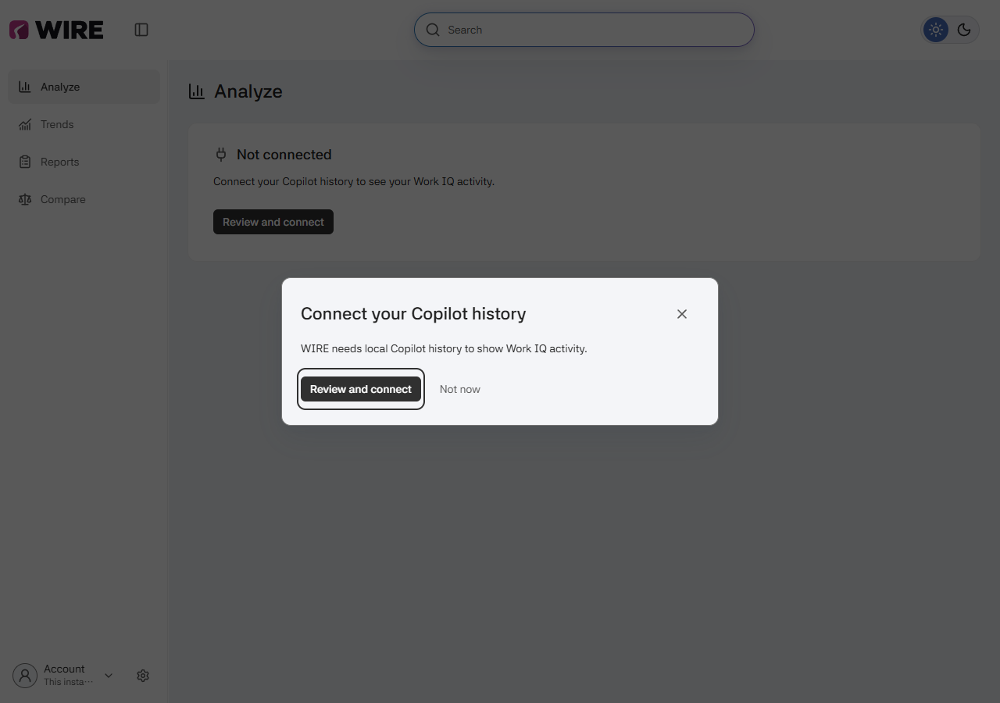
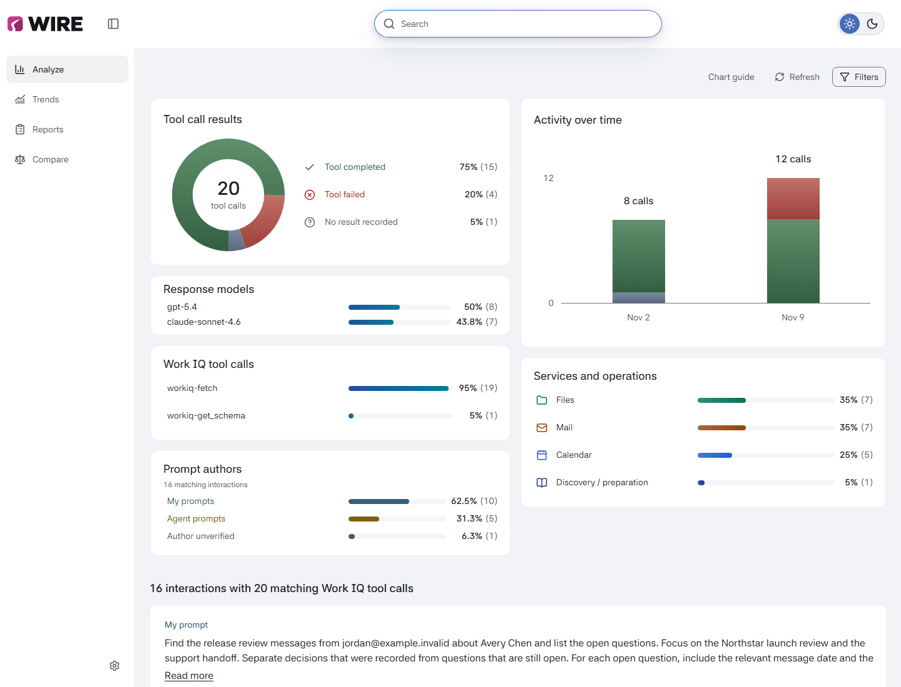
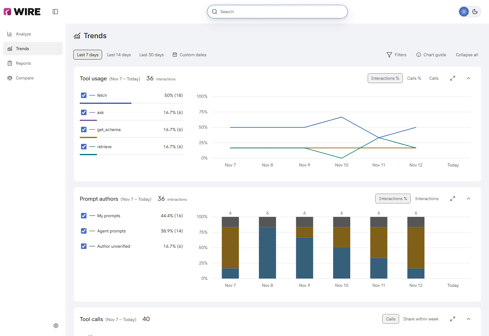
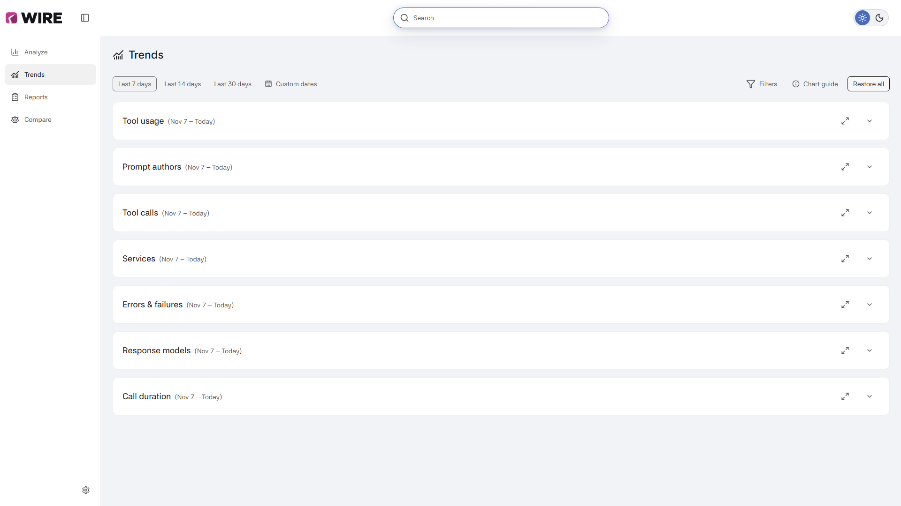
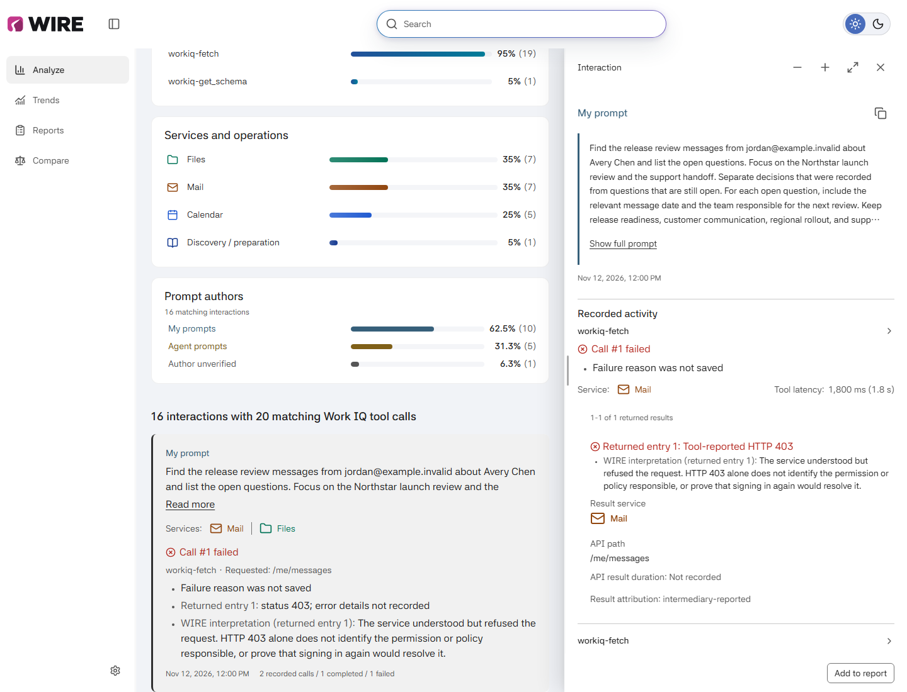
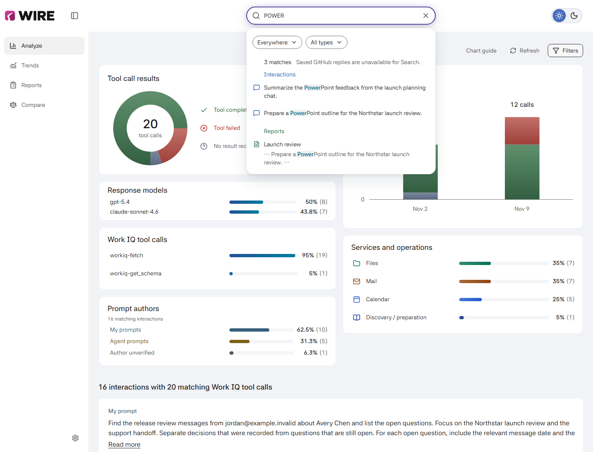
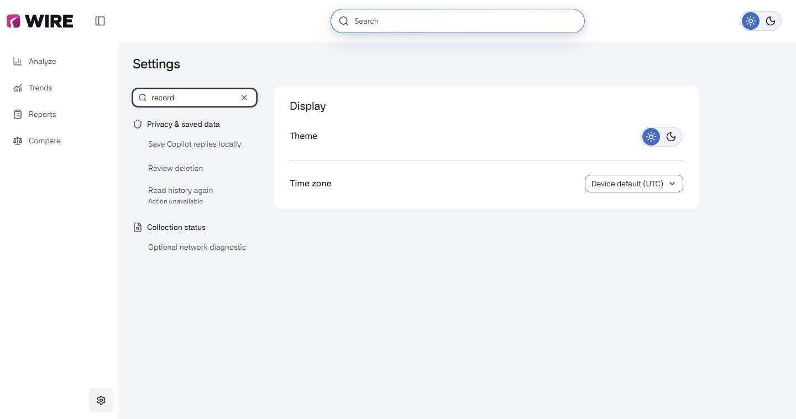
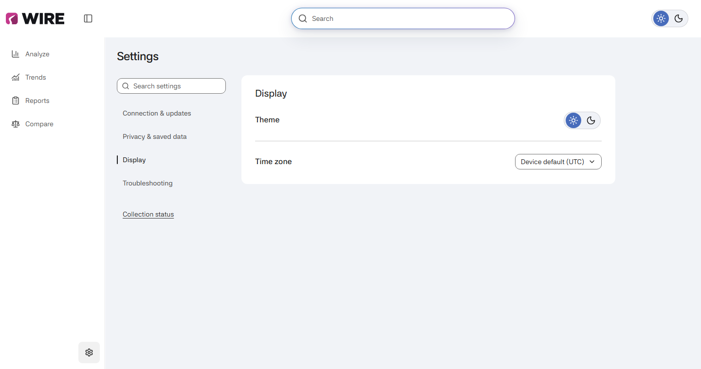

# Use WIRE

Use WIRE to inspect recorded Work IQ activity, find saved text and prepare
reports from your local GitHub Copilot app history.

Follow [setup](../README.md#getting-started) first. For WSL or a second instance beside
Windows, see [platform setup](development.md#windows-wsl-and-linux).

## Connect local history

WIRE prompts you to connect when you first open an unconfigured instance.

1. Choose **Review and connect** in the welcome. **Not now** closes it and leaves
   the connection prompt in Analyze. You can also use **Settings > Connection &
   updates > Review source & connect**.
2. Check **Copilot metadata database** and **Chat history folder**. These must
   point to the supported local Copilot installation whose history you want to read.
   Choose **Change paths** if either location is wrong.
3. Choose **History to include** and **Check frequency**, then select
   **Approve source and start collection**.
4. Choose **View activity** to open Analyze. The first read may take a few
   minutes; activity appears as it is saved. If expected calls are missing,
   open **Collection status** to see known history gaps.

The welcome stays dismissed in this browser at this WIRE address. Dismissing it
does not connect a source. Configured instances open normally, and Pause stays
paused. A missing source or failed read shows its own explanation instead of
asking you to keep waiting.

Repeat source approval in each independent instance. They keep separate
collection progress, settings, consent and saved reports. Collection can be on
while older history is still catching up; **Collection status** shows pending,
blocked, missing or bounded history rather than guaranteeing complete coverage.

Approval lets WIRE read that local history; it does not rerun prompts or make
new Work IQ requests. Microsoft 365 Chat and Cowork are not supported connections
in this release. Saving Copilot reply text is a separate choice under
**Settings > Privacy & saved data > Recorded replies** and starts off.

## Read the overview

**Analyze** shows recorded outcomes, activity over time, tools, services and
available response-model names, plus prompt authors. The interaction list below
follows the same filters. Open **Filters** to narrow the view by Dates, Tool, Service involved,
Outcome or Prompt author; **More filters** holds the additional choices.

An interaction groups a prompt with its recorded calls. One interaction can
contain several calls, and one call can involve several services. Service
shares can therefore overlap. Tool completion means the source recorded
completion, not that the answer was correct. Returned API entries, Graph call
sites and HTTP recorder captures have their own units; do not add them to
tool-call totals. Missing model names mean no name was recorded, not zero usage.
Breakdown rows show percentage first, with the count in parentheses. Model
percentages use all matching interactions, including those without model names;
an interaction with several recorded models counts under each.

**Prompt authors** counts each originating interaction once across all matching
pages: **My prompts**, **Agent prompts**, or **Author unverified**. Calls and
follow-ups do not add prompts. Unverified authors stay in the denominator;
missing prompt text alone does not make its author unknown. Microsoft 365
conversations without comparable prompt provenance are shown as unavailable,
not included in these shares.

Dates filter retained activity; they do not approve older source reads.
Custom dates include both days in the time zone chosen under
**Settings > Display > Time zone**. Missing history and records without qualified
times remain explicit. No matches means
no matching retained evidence, not proof that no activity occurred.

Author and Outcome choices remain a draft until **Apply**. **Reset filters**
clears browsing restrictions, not collected activity or report selections.
**Chart guide** explains the displayed measures and provides exact numbers.

## Trends

Choose **Trends** in the sidebar for full-width daily charts: tool usage,
prompt authors, tool calls, services, errors & failures, response models and
call duration. They use the available width in either monitor orientation.
The whole chosen period stays useful even when there are no calls today.

### Choose the period and activity

Use **Last 7 days**, **Last 14 days**, **Last 30 days** or **Custom dates**.
The applied range appears in parentheses beside every widget title.
Every date is labeled, including all 30 days: past dates show month and day,
and the current day says **Today**. Scroll inside a chart to read earlier dates;
new ranges open at the latest dates. Custom ranges over 90 days page through
days without changing full-period totals. Dates use the display time zone and
include both endpoints; choosing older dates does not collect older history.

**Filters** changes the activity included, even while a chart is maximized.
Apply author, tool and service choices together; Cancel leaves the scope alone,
and **Clear filters** restores the unrestricted period. The series checkboxes only
show or hide lines; they do not recalculate percentage denominators.

### Read the measures

Period breakdowns summarize the whole chosen range. A dated point uses that
day's matching population. Every chart's header lets you switch its measure
without maximizing it. **Chart guide** and **View numbers** explain the measures
and exact values.

| Chart | Measure |
| --- | --- |
| Tool usage | **Interactions %** shows the share of matching interactions that used a tool at least once (its reach). **Calls %** shows the tool's share of matching calls; **Calls** shows the count. Several tools can reach the same interaction. |
| Prompt authors | Matching originating interactions, split into My prompts, Agent prompts and Author unverified. Unverified authors stay in the denominator. |
| Tool calls | Matching tool calls per day. **Share within week** uses the matching calls in that calendar week within the selected dates. |
| Services | Matching calls involving each service, as a share of all matching calls. One call can involve several services, so shares can overlap. Missing service detail and preparation calls remain separate. |
| Errors & failures | Matching interactions with a failed call or recorded application/API error, as a share of all matching interactions. Unknown call outcomes are separate; a tool can complete while its result contains an error. |
| Response models | Matching interactions with each recorded model, as a share of all matching interactions. Multiple models can overlap, and interactions without a model name stay in the denominator. |
| Call duration | Recorded tool-call intervals in milliseconds, summarized as Median and 95th percentile. The coverage note identifies how many matching calls have qualified timing. |

Prompt authors counts interactions with activity that day, not every message
sent in Copilot. One interaction can appear on several days but counts once in
the whole period. Call duration shows Median and 95th percentile together; hiding either
series leaves the timing sample and coverage unchanged. Missing or partial
history, undated calls and unavailable measurements remain distinct from zero.
Collection status covers source-wide read/import problems; those do not establish
which dates are affected. Limits specific to the chart remain beside its values.

### Inspect a change

Hover or focus a dated mark to read its values. Arrow keys move between dates
and series. Select a point in the overview, then maximize its chart and choose
**View evidence** to see the calls for that exact date and series. Selection
keeps the chart in place; maximizing retains the selected point. Other series'
calls are not added to this list.
Hover a legend entry to emphasize its line without filtering the activity.

Open a call to read its result and full parent interaction. That parent context
can contain calls outside the chart selection. Closing the reader returns to
the same selected trend; hiding the selected series does not change its evidence.

**Back to overview** returns to the same place. Collapse or restore charts
without losing their measure, series choices or horizontal reading position.
Collapsed widgets show their names and applied dates. Click anywhere on a collapsed row to
open it, or the open widget's header to close it. The arrow button does the same
with Enter or Space; the other controls keep their own actions.

These are retained Work IQ patterns, not a census of Copilot prompts,
answer-quality judgments, productivity scores or evidence of causation.
For a two-period comparison or a saved copy, use
[Compare](#compare) or [Reports](reporting.md).

## Compare

Choose **Compare** in the sliding left sidebar. A fresh comparison
shows all eligible retained activity for the last seven complete days versus the
preceding seven. Analyze keeps its own filters and reading state.

Choose 14 or 30 days, or open **Custom dates** for independent inclusive ranges.
Use the compact activity choice for a starting point and **More options** for
additional restrictions. **Use Analyze view** explicitly brings its current
non-date filters and authorized Search into the comparison.

**Outcomes**, **Timeline**, **By tool** and **Timing** show the same pair.
**View calls** opens the records; **View numbers** explains the exact values.
**Create report** preserves the pair for local saving. See
[comparisons](reporting.md#compare) for scope and return behavior.

## Inspect an interaction

Open a card to read its prompt and recorded activity in the right-hand reader.
Long prompts start with a six-line preview so recorded activity stays close.
Choose **Show full prompt** to read the rest, or **Show less** to return to the
preview. Copy still includes the whole retained prompt. Search opens the full
prompt rather than hiding a match behind the preview.
Each call keeps its own result, timing and available error details. Open a
call's disclosure for exact input; **Source details** holds provenance and
identifiers. Close or Back returns to the originating results.

**WIRE interpretation** explains a recorded condition or evidence gap separately
from the source diagnostic. It uses fixed local rules, without AI or provider
calls, and explains what the evidence establishes without suggesting fixes or
next steps. A clear source explanation needs no additional interpretation.

Drag the reader's left edge or use its minus/plus buttons to narrow or widen
it. **Maximize interaction** fills the workspace below the toolbar;
**Restore reader width** returns to your chosen width while keeping your place.
**Close interaction** leaves the reader instead. When space is limited, WIRE
uses a single-pane reader and hides the sizing controls.

**My prompt**, **Agent prompt** and **Author unverified** describe supported
origin evidence, not who executed or authorized every call. Choosing My and
Agent is not the same as All, which also includes unverified authors.
The reader explains retained origin gaps separately from call results. For
example, WIRE may not recognize the host's message format even when the prompt
text and tool result were saved. Older records may lack that specific reason.

A file attachment may appear as a label such as `notes.md` rather than its
contents. WIRE keeps the text recorded in Copilot; it does not open the attachment
or add its local path.

**Tool latency** is the recorded call interval. **Prompt to final response**
measures from the originating message to its recorded final response when
that link is available. Concurrent calls are not added into a task duration.
Missing timing is not zero.

Copy controls copy the exact retained original, unmasked. A saved Copilot reply
is the assistant's text, not a tool result. Enabling reply saving does not
restore previously omitted replies.

**Add to report** changes selection only. **Continue to report** opens a report
of those selections. Use **Save report** to keep its files.

## Make a report

Open **Reports**, check **Report text**, then choose a ready-made report.
The default, **Mask detected details**, keeps the wording with local masking.
Change it before opening the report or while reading it. Keeping chat details
shows a red warning; masking can still miss names or sensitive wording.
Choose **Leave out prompts and replies** to omit chat wording. Notes and selected
error messages remain. The period starts at **Last 7 days**, independently of
your Analyze filters.

Read its patterns and supporting interactions, then optionally add a note or
edit a report copy. **Save as** chooses HTML, PDF, JSON or Markdown files;
**View** previews them. **Save report** keeps those files on this device.
If you keep chat details, the warning lets you hide details and save, save
with those details, or go back without writing anything.

Saved reports appear below the report choices. Select a name to read it, or use
**Files** to choose a format. **Back to Reports** returns to that workspace.
Saved files preserve their original facts and text. The
[report guide](reporting.md) explains each template's membership, how edits
affect an unfinished copy, and how to save, reopen or compare reports.

## Find saved text

Type in the stationary **Search** field. Results appear as you type; there is
no Submit step. `POWER` and `owerp` both find `PowerPoint`. A phrase matches
that literal sequence, not scattered words, inferred intent or synonyms.

**Everywhere** searches authorized retained content and navigation destinations
across pages. **Current Analyze scope** deliberately narrows the analytical
population and current-view report membership. Selected interactions and All
collected activity report scopes remain separate. Availability notices identify
content Search cannot include.

Open a result to inspect its exact verified destination. Back restores the
Search context while it remains authorized. Missing, changed or unreadable
content is not silently replaced with a nearby result. Search runs locally,
without AI, providers, new collection or credit spending. Its query is not
placed in URLs or saved as a persistent Search index.

## Find a setting

Open **Settings** at the bottom of the left sidebar and type in **Search
settings**. Matching destinations appear under their categories.
Search includes setting descriptions and keywords:
`record` finds reply saving, deletion, rereading history and the network
diagnostic; `city` finds Time zone.

Select a result, or use Tab and Enter, to reveal and focus the existing setting.
Its help and consequences stay beside that control. Selecting a result never
changes a setting, deletes activity or starts collection or a diagnostic.
Unavailable actions remain findable, with their explanation at the destination.
Clear the field or press Escape to return to the categories. Browser Back
returns to the query and link you came from.

This search runs on-device over fixed setting information. It is separate from
the main Search field for saved activity and reports, and does not read private
path values.

In **Display**, choose Light or Dark and a time zone for this browser.
The theme switch in the top toolbar changes the same preference.
Changing the display does not rewrite saved reports or their original time zone.

## Keep collection and saved data separate

**Settings > Connection & updates** owns source approval, history window,
check frequency and Pause. **Refresh** checks approved local history;
**Read stored activity** only rereads WIRE's retained view. Paused collection
stays paused after a deliberate local-history check. **Collection status**
explains missing files, bounded reads and other known coverage gaps.

If **Collection cannot check history** appears, open **Collection status** for
the failing operation and reason. Retained activity stays available.

Collector updates improve supported reads; they do not automatically repair
older retained activity or rewrite saved reports.

**Account > Sign out of this instance** stops collection and hides saved private
activity in every tab of that WIRE instance, without deleting it. It does not
sign out of GitHub, the Copilot app or another independent WIRE instance.
Account inherits the GitHub name and avatar from the approved Copilot app
source: the recorded workspace's linked account, otherwise the app's GitHub
default. This display profile does not control access to history. A neutral
icon means the profile is unavailable, not that collection needs a different
GitHub CLI login.

In **Privacy & saved data**, **Review deletion** previews an exact activity
scope before separate confirmation. **Read history again > Choose chats**
is a different, deliberate reread of selected approved history; restoring
deleted original prompts is an independent choice. Neither filter reset nor
ordinary Refresh performs these actions. Saved reports and external downloads
can retain copies after activity deletion.

If a change's result is uncertain, use its offered status/result check rather
than repeating the action. The [collection and recovery reference](collection.md)
explains each operation's effects and limits.
