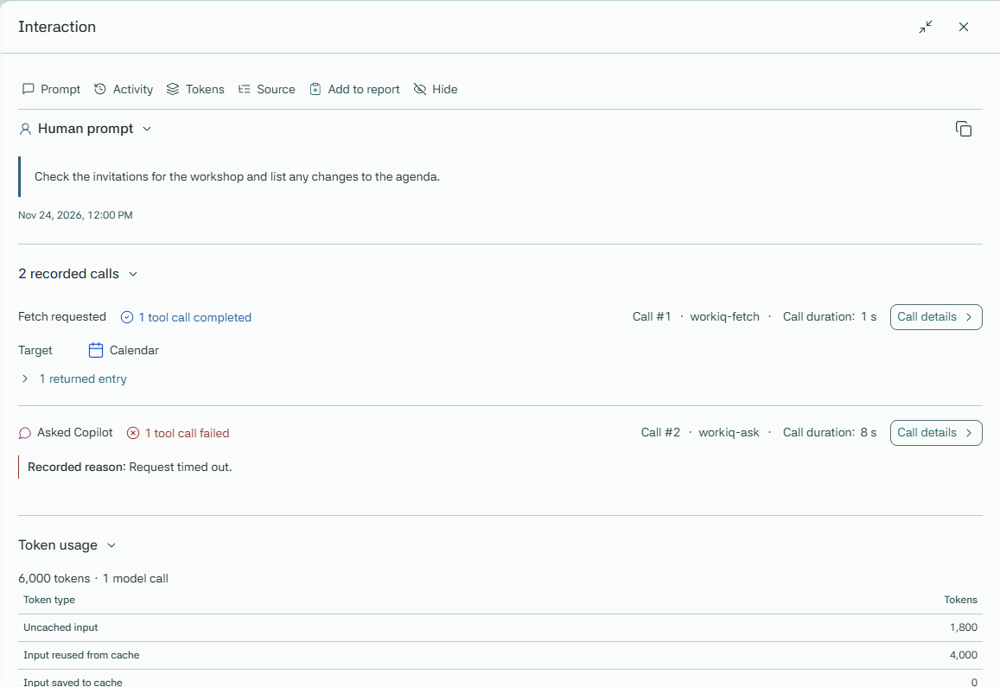
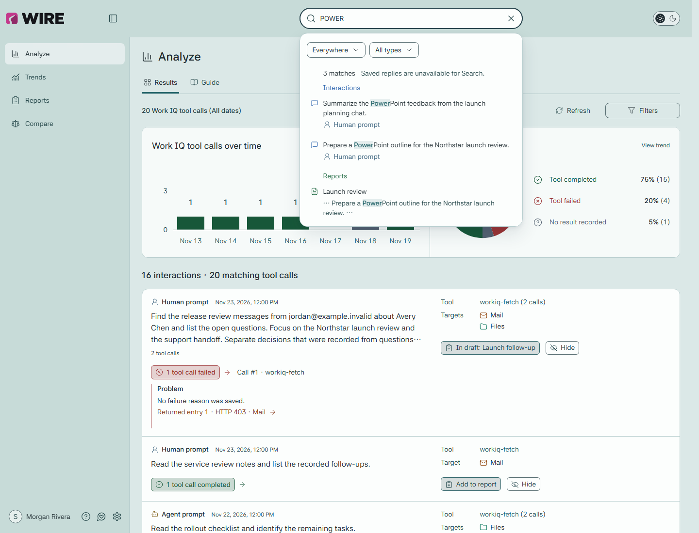
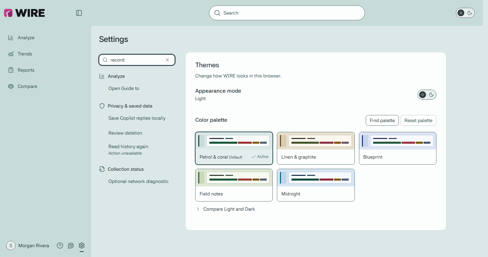
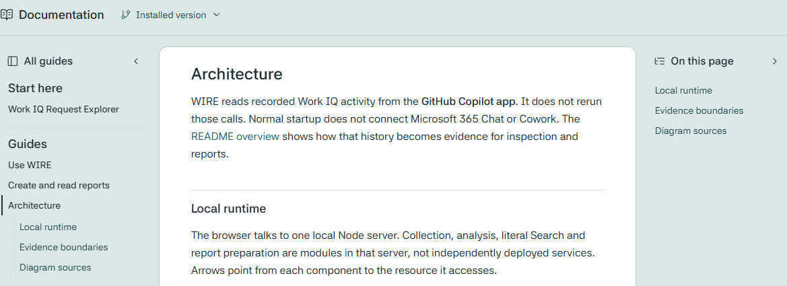

# Use WIRE

Use WIRE to inspect recorded Work IQ activity, find saved text and prepare
reports from your local GitHub Copilot app history.

Follow [setup](../README.md#getting-started) first. For WSL or a second instance beside
Windows, see [platform setup](development.md#windows-wsl-and-linux).

**Contents**

- [Pages and addresses](#pages-and-addresses)
- [Connect local history](#connect-local-history)
- [Analyze](#analyze): [charts](#read-the-charts), [prompt authors](#prompt-authors),
  [failed calls](#failed-calls-and-returned-entries), [filters and dates](#filters-and-dates),
  [services](#services-and-operations), [activity over time](#activity-over-time),
  [token usage](#token-usage), [Guide](#analyze-guide), [homepage layout](#homepage-layout)
- [Inspect an interaction](#inspect-an-interaction): [calls and results](#calls-and-results),
  [tokens](#tokens-and-returned-text), [prompt sender](#prompt-sender),
  [reader size](#resize-or-maximize-the-reader), [hide and restore cards](#hide-and-restore-cards)
- [Trends](#trends): [period and activity](#choose-the-period-and-activity),
  [measures](#read-the-measures), [compare two measures](#compare-two-measures),
  [what each chart measures](#what-each-chart-measures), [inspect a change](#inspect-a-change),
  [several charts](#show-several-charts)
- [Compare](#compare)
- [Make a report](#make-a-report)
- [Find saved text](#find-saved-text)
- [Settings](#settings): [search settings](#search-settings), [update WIRE](#update-wire),
  [themes](#themes), [defaults](#wire-defaults)
- [Collection, privacy and account](#collection-privacy-and-account)
- [Help, Feedback and the sidebar](#help-feedback-and-the-sidebar)
- [Documentation](#documentation)

## Pages and addresses

**Analyze is the home page.** Open the address printed by WIRE as-is. Trends,
Reports, Compare and Settings have their own addresses (`/trends`, `/reports`,
`/compare` and `/settings`), so you can bookmark a page or a Settings category.

Dates and filters change the results, not the address. A copied address opens
the page in a fresh tab with its own defaults, not your filtered results. Older
date and filter links still open their original scope with a clean address.

You can copy an ordinary interaction's address or refresh its reader. WIRE
reopens the same record only while it is still in the same local store. The
address doesn't contain its chat or record ID.

Search words, exact calls and source-specific filters stay private. Use
**Back** in the same tab to return to them. If you refresh or copy a private
view, WIRE may ask you to reopen the original record or repeat your Search
instead of showing a broader result.

## Connect local history

WIRE prompts you to connect when you first open an unconfigured instance.

1. Choose **Review and connect** in the welcome. **Not now** closes it and leaves
   the connection prompt in Analyze. You can also use **Settings > Source
   access > Review source & connect**.
2. Check **Copilot metadata database** and **Chat history folder**. These must
   point to the supported local Copilot installation whose history you want to read.
   Choose **Change paths** if either location is wrong.
3. Choose **History to include** and **Check frequency**, then select
   **Approve source and start collection**.
4. Choose **View activity** to open Analyze. The first read may take a few
   minutes; activity appears as it is saved. If expected calls are missing,
   open **Collection status** to see known history gaps.

The welcome stays dismissed in this browser at this WIRE address. Dismissing it
doesn't connect a source. Configured instances open normally, and Pause stays
paused. A missing source or failed read shows its own explanation instead of
asking you to keep waiting.

If Settings reports a problem after you approve:

- If it says the source settings were not saved, correct the paths or restore
  local access, then approve again.
- If it says the change is **unconfirmed**, read the current connection first.
  Don't repeat the write.

Each independent instance needs its own source approval. Instances keep
separate collection progress, settings, consent and saved reports.

Collection can be on while older history is still catching up. **Collection
status** shows pending, blocked, missing or bounded history; it doesn't
guarantee complete coverage.

Approval lets WIRE read that local history. It doesn't rerun prompts or make
new Work IQ requests, and WIRE doesn't connect to Microsoft 365 Chat or Cowork.
Saving Copilot reply text is a separate choice under
**Settings > Privacy & saved data > Recorded replies**, and it starts off.

## Analyze

**Analyze** shows recorded outcomes, activity over time, token usage, tools,
services, available response-model names and prompt authors. The interaction
list follows the same filters.

Open **Filters** to narrow the view by Dates, Tool, Service involved, Outcome or
Prompt author. **More filters** holds the additional choices.

### Read the charts

When Analyze opens, the charts build to the recorded counts. This isn't
collection progress. With reduced motion, the final values appear immediately.

In **Tool call results**:

- The donut shows the total. The strip shows how the calls split across
  outcomes; each label gives the percentage and exact count, even for a share
  too small to see.
- Choose the donut total to list the matching calls, eight per page. Open a
  call by its tool or path.
- A call's outcome describes the tool execution. Returned entries keep their
  own statuses in the call reader.
- **Show all matching activity** returns to the interaction list.

In the charts:

- Hover or focus a chart row to see what it means.
- Select a model or author to see its matching interactions.
- Select an outcome, or a segment of a dated bar, for that result. The number
  above a bar includes all results for the interval.
- Selecting a zero opens the chart definition instead of a list of records.

An interaction groups a prompt with its recorded calls. One interaction can
contain several calls, and one call can involve several services, so service
shares can overlap. When you read the numbers:

- Tool completion means the source recorded completion, not that the answer was
  correct.
- Returned API entries, Graph call sites and HTTP recorder captures have their
  own units. Don't add them to tool-call totals.
- A missing model name means no name was recorded, not zero usage.
- Breakdowns show the percentage first, with the count in parentheses. On wide
  tool and model cards, read each pair from left to right, then down.
- Model percentages use all matching interactions, including those without
  model names. An interaction with several recorded models counts under each.

### Prompt authors

**Prompt authors** counts each originating interaction once across all matching
pages.

- **Human prompts** came from a person.
- **Agent prompts** came from an agent.
- **Sender unclear** means WIRE can't tell from the saved record which one sent
  the prompt. Select that row to see the reason on each card. These prompts
  still count.

Calls and follow-ups don't add prompts, and missing prompt text alone doesn't
make the sender unclear.

In the reader, **Source** shows whether a call links directly to the prompt or
is grouped by message order. A skill or system message before a call doesn't
tell you who asked for the work.

### Failed calls and returned entries

Find the prompt in the list and follow its outcome link. The right-hand reader
shows the tools, services and results.

Notes such as **1 tool call failed** and **Reported result issue** point to
different problems. A tool call can complete and still return an error for an
individual item.

On an Analyze card:

- **2 tool calls failed** opens both failed calls. The **Problem** area names
  the affected calls and shows what went wrong. If no reason was saved, the
  card says so.
- **Returned entry 2 · HTTP 400** opens that particular result, not the first
  error or another entry with the same status.

Open the reader for the full retained wording, code and status. A missing
completion doesn't establish that anyone cancelled the call.

### Filters and dates

Analyze Filters, Trends, Reports and Compare share the same date choices.

1. Open **Dates** and choose a preset, or choose **Custom dates** to edit below
   the presets.
2. For custom dates, select a start and end on the calendar, or type them.
3. Choose **Apply dates**. **Cancel** keeps the previous range.

In Compare, select a period's date label to edit just that period.

- Custom dates include both days in the time zone chosen under
  **Settings > Regional > Time zone**.
- Today is the latest date you can use. **This week** and **This month** also
  end today.
- Dates filter retained activity. They don't approve older source reads.
- Missing history and records without qualified times stay marked as such. No
  matches means no matching retained evidence, not proof that no activity
  occurred.

Author and Outcome choices remain a draft until **Apply**. **Reset filters**
clears browsing restrictions, not collected activity or report selections.

**Filters** also shows how much history WIRE has checked. A routine partial
check stays there while results are available. An empty result can explain
what history was checked; an actual read error still appears with the results.

To read one conversation:

1. Open **Filters** and expand **More filters** if needed.
2. Choose **Chat**. In a long list, type part of its title to narrow the
   choices.
3. Choose the row. Escape leaves the selection alone.

A chat is a conversation recorded by the Copilot app. A WIRE sign-in session
controls access to this local instance. Choosing a chat doesn't switch
accounts, sign out or read new history.

### Services and operations

In **Services and operations**:

- **Search endpoint** means the recorded path identifies a search endpoint.
- **Search requested** means the tool requested a search without naming a
  target app.
- **Business app not named** means the recorded path was `/businessapps/me`;
  WIRE can't identify the app.

Each row opens its matching records. A call with several targets can appear in
more than one row.

On an interaction card, an operation or service detail with a right arrow opens
the matching call:

- **API discovery**, for example, opens the call that looked for available
  paths, not a later call that fetched data.
- **Exchange ID conversion** identifies a request to convert item IDs. It
  doesn't identify the mailbox item.
- If several calls match, the link says **first of N calls**.
- Without a matching retained call, the label has no link.

To inspect a path:

1. Choose **Guide > Paths and operations > See exact numbers**.
2. Select the path or batch, then open the matching interaction.
3. In the reader, expand a numbered call to see its target and result.

Read the targets and outcome on the individual call rather than inferring them
from the interaction summary.

### Activity over time

The **Work IQ tool calls over time** chart shows individual calendar days by
default, even with All dates or a long range.

- If the days don't fit across the chart, scroll horizontally.
- Long timelines show up to 90 intervals at a time, starting with the latest
  dates. Scroll within that window, or use **Earlier dates**, **Later dates**,
  **First dates** and **Latest dates** to reach the rest.
- The window names its dates. Totals and filters still cover the whole selected
  period, and paging doesn't change which interactions a report includes.
- If an old link points outside the current dated activity, **First dates** or
  **Latest dates** returns to its recorded dates without clearing your filters.

**Guide > Activity over time > See exact numbers** has the window's exact daily
rows and the dated total for the full selected period.

A zero means no qualifying retained calls that day, not proof that no activity
occurred. Undated calls stay outside the timeline.

Existing links that explicitly request weekly or monthly grouping keep that
interval when dates change. Compare's separate Day/Week/Month control doesn't
change Analyze.

### Token usage

**Token usage** labels each day in the chosen range, including
days without a count. Scroll along the date axis on narrow screens or long
ranges; periods over 90 days have earlier and later windows. Hover over a point
to see its date and token count beside the pointer. Tap a day or use the arrow
keys to inspect it. A dot on zero is a measured zero. For a gap,
the date reading distinguishes activity without a count from no matching activity.
WIRE leaves gaps between measured days; it doesn't estimate the missing usage.
Click or tap to hold a reading, then select its date to open the evidence in
Trends. Choose **View by day** for the whole period.

Choose **Most tokens** in **Sort** above the Analyze list to find the
interactions that used the most. Each metered card shows its total.
In **Response models**, choose **Token share** to compare each model's share
of the recorded tokens. Select a model to see only the interactions with token
counts for that model. **Interactions** also includes uses without token counts.

In **Interactions** mode, choose a model to show its cards. Open **Filters** to
see or remove that model under **Applied filters**. This narrows the card list;
the chart still shows all models in your date range and other filters.

### Analyze Guide

Under **Analyze**, choose **Results** to inspect activity or **Guide** to read
about recorded outcomes. The underline marks the current section. **Refresh**
and **Filters** apply to Results and stay out of the Guide.

- Pick another topic beside the explanation, or use **Topics** on a narrow
  screen.
- Worked examples illustrate distinctions, such as a completed call returning
  an error for one item. They aren't records from your activity.
- **See exact numbers** shows values in your current scope, with matching
  records where available.
- **Results** or browser Back returns to the same filtered results and reading
  position.

**Settings > Analyze > Open Guide to** chooses whether the Guide opens at
recorded outcomes (the default) or the last topic read in this tab. This
preference doesn't change the charts.

### Homepage layout

In **Settings > Analyze > Homepage layout**, use the arrows to move a widget or the
**Interactions** list. The preview outlines the section you moved and shows which
breakdowns share a row. The time chart, tool call results, token usage and
Interactions each keep their own row.
Your browser remembers each move. Choose **View Analyze** to open the homepage.
**Restore WIRE Default Layout** returns the sections to their original order.
An older custom layout keeps its order and adds the usage widget at the end.
**Default interaction sort** sets the starting order; sorting above the list
changes this visit only. Neither setting changes your filters or activity.

## Inspect an interaction

The count above the cards follows your filters. **Collection status** shows
the contributing chats, projects and source coverage. An actual coverage
warning stays beside the affected activity.

Hover highlights a card, but the card itself isn't a link. To open the
right-hand reader, select the outcome below the prompt preview. Hover over its
arrow or focus the link to see **View call details**.

### Calls and results

In the reader, choose **Prompt** to read and copy the retained original.
**Human prompt**, **Agent prompt** or **Sender unclear** describes where the
prompt came from, not its app.

Outcome labels open the calls they count:

- **1 tool call failed** opens the failed call. It doesn't mean the whole
  request failed.
- **4 tool calls completed** opens those four calls. Calls your filters exclude
  stay out of that list.
- A completed call can still contain a returned API error. When a tool fails
  and another call returns an issue, use their separate links.

Repeated tools show a count with its unit. Tools, requested targets and
operations are separate; a search or Copilot request doesn't confirm which apps
were used.

Long prompts start with a six-line preview so the recorded activity stays
close.

- Use the chevron beside the prompt author to expand or collapse the text in
  place.
- **Copy prompt** still copies the whole retained prompt.
- Search opens the full prompt rather than hiding a match behind the preview.
- **Prompt**, **Activity** or **Source** at the top of the interaction jumps to
  that section. **Reply** appears when the interaction has a recorded reply.

Each call shows its own outcome, such as **1 tool call completed**, even if one
returned entry reported an error.

- **Call duration** measures the whole call.
- Returned entries stay in order and carry their own statuses and timing.
- If an error message is shortened, **Full diagnostic** opens its saved
  wording.
- Open the call for its exact input. **Source details** holds provenance and
  identifiers.

Close or Back returns to the originating results.

**WIRE interpretation** explains a recorded condition or evidence gap,
separately from the source diagnostic. It uses fixed local rules, without AI or
provider calls. It says what the evidence establishes and doesn't suggest fixes
or next steps. A clear source explanation needs no extra interpretation.

Timing:

- **Tool latency** is the recorded call interval.
- **Prompt to final response** measures from the originating message to its
  recorded final response, when that link is available.
- Concurrent calls aren't added into a task duration. Missing timing isn't
  zero.

A file attachment may appear as a label such as `notes.md` rather than its
contents. WIRE keeps the text recorded in Copilot; it does not open the attachment
or add its local path.

Copy controls copy the exact retained original, unmasked. Readers show
Markdown in prompts and replies as formatted text, including tables and links;
Copy still returns the original Markdown. A saved Copilot reply
is the assistant's text, not a tool result. Enabling reply saving does not
restore previously omitted replies.

### Tokens and returned text

On an interaction card or in the reader header, read the count or **Tokens
unavailable**. Select the header reading for the breakdown or the known reason.
The breakdown separates fresh input, cache reads, cache writes and output.

To inspect one invocation, open **Call details** for its numbered row:

- **Tool operation tokens** shows what the tool service reported for that call,
  when available.
- **Returned text (estimate)** describes the size of its response.

Neither figure is a share of the model's token total.

To report on one interaction, choose **Add to report** on its card and add it
to a new draft. Open that draft in Reports to save the same total. Adding more
interactions gives you their combined total and how many had token counts.

### Prompt sender

The sender label tells you who asked, not who carried out each call. Choosing
Human and Agent excludes prompts whose sender is unclear. Those cards show the
saved reason separately from the call result.

Two places explain an unclear sender:

- In **Analyze > Guide > Recorded prompt authors**, **Why the sender is
  unclear** counts the reasons across all pages of the current view and shows
  the saved rule version when available.
- In the reader, **Source details** shows the selected prompt's saved rule
  version and whether its calls link directly to that prompt.

Neither view rereads chats or changes an author. For example, WIRE may not
recognize the host's message format even when the prompt text and tool result
were saved. Older records may lack that specific reason.

### Resize or maximize the reader

Drag the reader's left edge or use its minus and plus buttons to change its
width. On a narrow screen, the reader uses one pane without sizing controls.

Choose **Maximize interaction** to read the calls across the workspace. Each
call shows its operation and outcome together, and a recorded failure reason
stays with the call it explains. **Call details** opens that call's evidence.

**Restore reader width** keeps your place. **Close interaction** returns to the
previous view.

### Add to a report

Use **Add to report** on the card or in its reader. Choose a draft to add the
entire interaction without leaving Analyze. Reopen the picker to add it to
another draft or remove it from one.

See [Keep interactions in a draft](reporting.md#keep-interactions-in-a-draft)
to prepare, save or delete that selection.

### Hide and restore cards

On a local Copilot interaction card in Analyze, choose **Hide**. To bring cards
back:

- Right away: choose **Undo hide** above the list.
- Later: open **Hidden cards** and choose **Restore** beside a card.
- All at once: choose **Restore all** below the list.

Cards stay hidden until you restore them. For a shorter time, go to
**Settings > Analyze > Keep hidden cards out of view** and choose **Only in
this tab**. The setting applies the next time you hide a card.

What hiding changes:

- Counts in Analyze, Trends and Compare stay the same.
- The card's prompt and call details stay out of view, including in Search.
- A report draft keeps its selection, but WIRE won't show a preview that could
  reveal the card.
- While any card is hidden in this tab, **all saved reports and comparisons**
  stay closed in WIRE and out of Search. Even a report about other work can
  quote the hidden interaction.
- Files you've saved or shared don't change.

## Trends

Choose **Trends** in the sidebar. **Overview** opens first and shows how many
interactions had a recorded error or failure each day.

- A cross at zero means no matching dated calls.
- A circle at zero means there was activity but no recorded error.

**Charts** lists eight measures. **Chart guide** explains their units.

**Token usage** shows how many tokens the metered interactions used.

- Narrow by prompt author or tool to see the whole interactions that match.
- **Usage question** charts Human, Agent and unverified prompts, tools in
  interactions with at least 30,000 or 60,000 tokens, or the models that read
  from cache.
- **View daily values** shows daily readings and coverage.
- Tool groups overlap. An interaction that used both fetch and retrieve appears
  in both, but its tokens count once in the period total.

On Analyze, choose **View trend** on a widget to open its measure here:

- With **All dates**, the trend spans the first through last dated calls in the
  current view.
- **Response models** opens interaction counts or measured tokens by model,
  following the switch on the widget.
- From **Tool call results**, WIRE asks before showing **Errors & failures**,
  because that chart counts affected interactions, not call outcomes.
- **Back to Analyze** restores the original widget.

### Choose the period and activity

Open **Dates** for **Last 7 days**, **Last 14 days**, **Last 30 days** or
**Custom dates**. Dates use the display time zone and include both endpoints.
Choosing older dates doesn't collect older history.

With no period selected, Trends starts with the last seven days.

- If that week is empty and older dated calls exist, **Latest activity** shows
  the seven days ending on the most recent matching call.
- An explicit period or Analyze widget never moves automatically. An empty
  period can offer **Show week ending …** without dropping the active filters.
- While a new read is pending, the period control shows the accepted dates.

Reloading the same tab keeps its chart measure and ordinary date choices. The
address can reopen the Charts section, not a chart's settings. Private filtered
selections stay in the original visit.

If WIRE can't restore a private selection, reopen the result from its original
tab. To continue without it, choose **Open this view without the private
selection**. Neither action deletes saved activity.

Long periods:

- Every civil day is available in **View daily values**.
- Long single-series charts space out date labels to show more of the period.
- If the chart scrolls, the dates in view are shown below it. The index first
  shows the span with the most calls.
- Custom ranges over 90 days page through days without changing full-period
  totals. The table caption names the daily rows shown.
- **Earlier days** and **Later days** change pages. At either end, keyboard
  focus moves to the direction still available.

**Filters** changes the activity included, even while a chart is maximized.
Apply author, tool and service choices together. Cancel leaves the scope alone,
and **Clear filters** restores the unrestricted period. The series checkboxes
only show or hide series; they don't recalculate percentage denominators.

### Read the measures

Period breakdowns summarize the whole chosen range. A dated point uses that
day's matching population.

Chart controls:

- **Count / Percentage** changes compatible measures. Tool percentages can use
  calls or originating interactions. Duration stays in milliseconds.
- **Columns / Lines** changes the drawing, not the values.
- Select a point for its exact daily reading and matching calls.

#### Compare two measures

**Compare measures** lets you choose two readings for the same dates, or start
from an example on Overview.

For example, compare **Errors & failures · interaction share** with a tool's
**interaction reach**. Both count matching interactions that day, so they can
share one graph.

Measures with different denominators or units use aligned charts instead. Call
share uses a different denominator; call volume and duration use different
units. Aligned charts share a vertical scale when their units and denominators
match.

- **Share within week** marks each week boundary. Its line stops there because
  the next point uses a different denominator. Select a date to see that week's
  selected dates.
- **Remove comparison** drops the second measure. **Collapse chart** keeps your
  choices.
- **Daily values** includes both measures on the current date page.
- The optional correlation describes that page's paired daily values, not
  causation or individual calls.

**Compare periods** is different: it compares this period with the preceding
period of equal length. Review the dates and scope before opening Compare.
**Back to Trends** returns to the pair and selected day.

#### Columns, zeros and gaps

Grouped columns sit above the date they belong to, in the legend's colors.
Select a column for its name and exact reading.

- One zero under a date means all **shown** series are zero.
- A dash means the measurement is unavailable.
- If none of the matching interactions has a token count, WIRE shows the
  coverage instead of an empty plot.

**Token usage** starts as a line:

- A measured zero sits on the zero axis.
- A dash marks work with no reading for that day.
- A date without matching calls stays blank.
- Select a measured day to open its contributing calls. On an unmetered day,
  open a call to see why its interaction has no count.
- Later calls from an interaction already counted on an earlier date don't add
  its tokens again.

**View daily values** includes daily numbers and period totals, including
series hidden in the chart.

#### What each chart measures

| Chart | Measure |
| --- | --- |
| Tool usage | **Interactions %** shows the share of matching interactions that used a tool at least once (its reach). **Calls %** shows the tool's share of matching calls; **Calls** shows the count. Several tools can reach the same interaction. |
| Prompt authors | Matching originating interactions, split into Human prompts, Agent prompts and Sender unclear. Prompts with an unclear sender still count. |
| Tool calls | Matching tool calls per day. **Share within week** uses the matching calls in that calendar week within the selected dates. Point context names that week and denominator; a short rule along the date axis marks partial weeks. |
| Services | Matching calls involving each service, as a share of all matching calls. One call can involve several services, so shares can overlap. Missing service detail and preparation calls remain separate. |
| Errors & failures | Matching interactions with a failed call or recorded application/API error, as a share of all matching interactions. Unknown call outcomes are separate; a tool can complete while its result contains an error. |
| Response models | Each model counts once per matching interaction. An interaction can use several models. Percentages include interactions without a verified model in the denominator. In **View daily values**, select a partial, missing, unverified or conflicting model count to open its matching calls. The interaction reader shows what was recorded. |
| Call duration | Median and 95th percentile of recorded durations, in milliseconds. A blank date has no matching calls; a dash means calls had no recorded duration. **View daily values** shows both the number of calls and how many were timed. |
| Token usage | Each matching interaction contributes its tokens once, on its first matching call date in the period. The coverage count shows how many interactions have a token reading. |

More on specific charts:

- **Prompt authors** counts interactions with activity that day, not every
  message sent in Copilot. One interaction can appear on several days but
  counts once in the whole period.
- **Call duration** shows Median and 95th percentile together. Its header
  buttons are shortcuts for the same series checkboxes. Hiding either series
  leaves the timing sample and coverage unchanged.

Missing or partial history, undated calls and unavailable measurements stay
distinct from zero. Collection status covers source-wide read and import
problems, which don't establish which dates are affected. Limits specific to a
chart stay beside its values.

### Inspect a change

Hover or focus a dated mark to read its values. Arrow keys move between dates
and series. Hover a legend entry to emphasize its line without filtering the
activity.

1. Select a point. Selection keeps the chart in place, and there's no need to
   maximize first.
2. Choose the action showing its matching call count. Other series' calls
   aren't added to this list.
3. Open a call to read its result and full parent interaction. That parent can
   contain calls outside the chart selection.

Closing the reader returns focus to the supporting-calls action. Reopening the
list returns to the call you were inspecting.

- Maximizing keeps the selected point.
- Changing the scope retires that return position.
- Hiding the selected series doesn't change its evidence.
- The list's title and Close stay available while it scrolls.

Choose **View daily values** below the chart for the numbers. On a narrow
screen, scroll within the table; keyboard users can focus it and use the arrow
keys. Dates and column headers stay attached to the values.

### Show several charts

To read several charts for the same dates:

1. Choose **Show or hide charts** above the chart.
2. Check the charts to show below it.
3. Choose **Apply**.

Uncheck them all to keep just the current chart. Choosing another measure in
the index starts with that chart alone. Extra charts aren't kept on reload.

For the full-width stack, choose **Show or hide charts > Open all charts**.

- **Back to selected charts** returns to your selection.
- From a maximized chart, **Back to all charts** returns to its row.
- **Collapse all** folds the current stack; **Expand all** opens every chart in
  it. Neither changes your measures, series choices or selected date.

Collapsed widgets show their names and applied dates. Click anywhere on a
collapsed row to open it, or on the open widget's header to close it. The arrow
button does the same with Enter or Space; the other controls keep their own
actions.

Trends shows retained Work IQ patterns. It isn't a census of Copilot prompts,
an answer-quality judgment, a productivity score or evidence of causation. For
a two-period comparison or a saved copy, use [Compare](#compare) or
[Reports](reporting.md).

## Compare

Choose **Compare** in the sidebar to compare two periods. To compare two
measures over *one* period, stay in Trends. See [Compare two periods](reporting.md#compare)
for baseline and selected dates, missing values, token usage and the calls behind a change.

## Make a report

In **Reports**, choose a report under **New report** to open its preview.
**Token usage** follows **Errors & failures**. Use **Custom report** to change
the setup first, or open a name in **Drafts** and choose **Prepare preview**.
Preparing does not save files. Read the finding and its examples before choosing
**Save report**. Open an existing report by name in **Saved library**.

[Create and read reports](reporting.md) covers scope, text masking, file
inspection, and what happens when you delete a draft or a saved copy.

## Find saved text

Type in the stationary **Search** field. Results appear as you type; there's no
Submit step.

- Matching is literal and ignores case: `POWER` and `owerp` both find
  `PowerPoint`.
- A phrase matches that exact sequence, not scattered words, inferred intent or
  synonyms.

Choose where to search:

- **Everywhere** searches authorized retained content and navigation
  destinations across pages.
- **Current Analyze scope** narrows to the analytical population and the
  current view's report membership.

Selected interactions and All collected activity report scopes stay separate.
Availability notices name any content Search can't include.

Open a result to inspect its exact verified destination. Back returns to the
matching row while it's still available. If you start a new search while the
reader is closing, WIRE keeps the new query.

Missing, changed or unreadable content isn't silently replaced with a nearby
result. Search runs locally, without AI, providers, new collection or credit
spending. Your query isn't placed in addresses or saved as a persistent Search
index.

## Settings

Open **Settings** at the bottom of the left sidebar. It opens in **General**,
which shows your WIRE version, update status and last successful check.

Below updates, **Current theme** shows your palette name, Light or Dark mode,
and a preview with its colors.

- **Change theme** opens **Themes**.
- **Time zone** opens **Regional**.
- **Back to General** returns to the shortcut with your current choice.

### Search settings

Type in **Search settings**. Matching destinations appear under their
categories. Search includes setting descriptions and keywords: `record` finds
reply saving, deletion, rereading history and the network diagnostic; `city`
finds Time zone.

Select a result, or use Tab and Enter, to reveal and focus the setting. Its
help and consequences stay beside the control.

- Selecting a result never changes a setting, deletes activity or starts
  collection or a diagnostic.
- Unavailable actions stay findable, with their explanation at the
  destination.
- Clear the field or press Escape to return to the categories. Browser Back
  returns to the query and link you came from.

This search runs on your device over fixed setting information. It's separate
from the main Search field for saved activity and reports, and it doesn't read
private path values.

### Update WIRE

On [supported installations](development.md#updating-wire), automatic checks
are on by default. You can turn them off and still choose **Check for updates**
in **General**. The button shows **Checking** while it looks for an update.

To install an update:

1. Choose **Update and restart** in General or in the update notification.
2. Leave your tabs open. Each participating window shows **WIRE is updating**,
   then reloads its own page.

If a window has an unfinished edit, save or cancel it there before updating. If
a window doesn't confirm it's ready, WIRE stops before restarting. That message
alone doesn't mean you left an edit unfinished.

**Check open views** in General asks the registered views whether they have
unfinished work, when an update is available. It doesn't install anything. If a
view doesn't answer, keep your windows and work intact; another update click
won't tell you which view was missing. WIRE checks again when you choose to
restart.

- Dismissing the notification leaves the update available in General.
- If installation fails, General shows **Update not installed** and the
  reason. Away from General, the notification shows the same message.
- If your copy can't check for updates, General links to **Update
  instructions** instead.

### Themes

In **Themes**, choose Light or Dark and one of five color palettes for this
browser. The toolbar switch changes only Light or Dark. Change the time zone
separately in **Regional**.

- Select a palette card to change the screen immediately.
- **Compare Light and Dark** shows the selected palette in both modes.
- **Reset palette** restores Petrol & coral without changing the mode.

If storage is unavailable, the choice applies to this panel only. Changing
appearance doesn't rewrite saved reports or their original time zone.

### WIRE defaults

Under **WIRE defaults**, choose how views open and how new reports and
comparisons start in this browser:

| Category | What you can change |
| --- | --- |
| Analyze | Open on All dates (the initial default) or the last 7, 14 or 30 days, including today. **View Analyze** and the sidebar use this range for a fresh view and keep any dates or filters you chose in an existing view. This filters saved activity. Start the list with **Most recent** or **Most tokens**, choose Guide's opening topic, or [reorder the homepage widgets and Interactions](#homepage-layout). |
| Trends | Choose the trend chart to show on a fresh visit. Changing measures within Charts does not change its address. |
| Reports | Preselect HTML, PDF, Markdown or JSON (at least one), and the last 7, 14 or 30 days including today. These choices start a fresh draft; they do not prepare or save files. |
| Compare | Start with the last 7, 14 or 30 complete days, ending yesterday, versus the preceding period of the same length. A comparison from Trends keeps its chosen dates. |

Defaults don't rewrite a view you return to, an existing draft or a saved
report. If the browser can't save a preference, Settings says the choice
applies only to the current panel.

## Collection, privacy and account

**Settings > Source access** shows which paths WIRE can read.

**Collection** sets the history window, check frequency and Pause. Edit a value
to show **Save preferences** and **Cancel changes**.

- **Refresh** checks approved local history.
- **Read stored activity** only rereads WIRE's retained view.
- Paused collection stays paused after a deliberate local-history check.
- **Collection status** explains missing files, bounded reads and other known
  coverage gaps.

If **Collection cannot check history** appears, open **Collection status** for
the failing operation and reason. Retained activity stays available.

In Collection status, **HTTP recorder** shows any saved diagnostic. Normal WIRE
launches can't start a new network test, and a saved diagnostic is separate
from Copilot collection status.

Collector updates improve supported reads. They don't automatically repair
older retained activity or rewrite saved reports.

In **Privacy & saved data**:

- **Review deletion** previews the activity you choose before you confirm
  deletion.
- **Read history again > Choose chats** checks selected approved history for
  missing activity. It can't restore deleted calls or prompts in a normal
  installation.

Neither Reset filters nor Refresh performs these actions. Saved reports and
external downloads can keep copies after activity is deleted.

If a change's result is uncertain, use its offered status or result check
rather than repeating the action. The [collection and recovery reference](collection.md)
explains each operation's effects and limits.

Open **Account** at the bottom of the navigation (inside the navigation drawer
on small screens).

**Account > Sign out of this instance** stops collection and hides saved
private activity in every tab of that WIRE instance, without deleting it. It
doesn't sign out of GitHub, the Copilot app or another independent WIRE
instance.

WIRE reads the GitHub name and avatar from the approved Copilot app source: the
recorded workspace's linked account, otherwise the app's GitHub default. This
display profile doesn't control access to history. A neutral icon means the
profile is unavailable, not that collection needs a different GitHub CLI login.

## Help, Feedback and the sidebar

Open **? (Help)** at the bottom of the sidebar for **Prepare a report**,
**Find missing activity**, **Understand activity counts** or **Read tool
results**. Select a topic to read its answer. Your browser's Back and Forward
buttons revisit topics and earlier pages. Chart definitions and examples stay
in the Analyze and Trends guides.

Use **Feedback** beside Help to report a WIRE bug or suggest a feature:

1. Enter a title and, optionally, a description.
2. Choose **Open on GitHub** to fill in those fields on WIRE's new issue form.

The issue is public only after you submit it.

To resize the sidebar, drag its right edge, or focus the divider and use the
left and right arrow keys. WIRE remembers your width in this browser.
Double-click the edge or press Enter on it to restore the default.

## Documentation

Select **Documentation** at the bottom of the sidebar, just above your account,
to read these guides inside WIRE.

The list on the left shows every guide, with the sections of the one you're
reading. The list on the right shows the sections on the current page and marks
where you are. In a narrow window, both lists fold into **All guides** and
**On this page** above the text.

Links, section addresses and your browser's Back and Forward work as they do on
any web page. You can bookmark a section or share its address.

The line under each title says which guides you're reading:

| You see | What it means |
| --- | --- |
| **From GitHub main** | The current guides from the WIRE repository. WIRE checks for newer ones when you open Documentation, at most every 15 minutes. Select **Check now** to check again. |
| **Couldn't reach GitHub main** | The check failed. You're reading the guides WIRE last fetched, which may not be the latest. |
| **Guides included with this WIRE build** | WIRE hasn't fetched GitHub main yet, or this copy doesn't come from the WIRE repository. |

Newer guides appear without updating WIRE. A check fetches only the
repository's main branch into WIRE's own Git data. It doesn't change your files,
settings or installed version. Images come from the same version as the text.
Images hosted on other sites aren't loaded; WIRE shows a link to them instead.

If you're editing guides in your own clone or fork, see
[Preview documentation changes](development.md#preview-documentation-changes).
