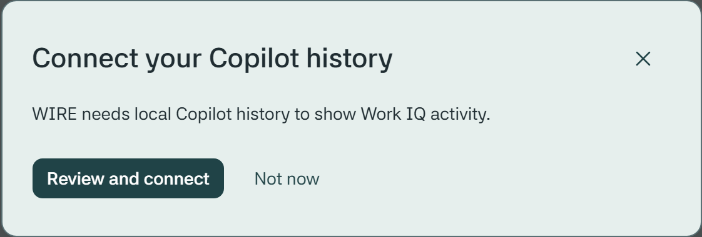
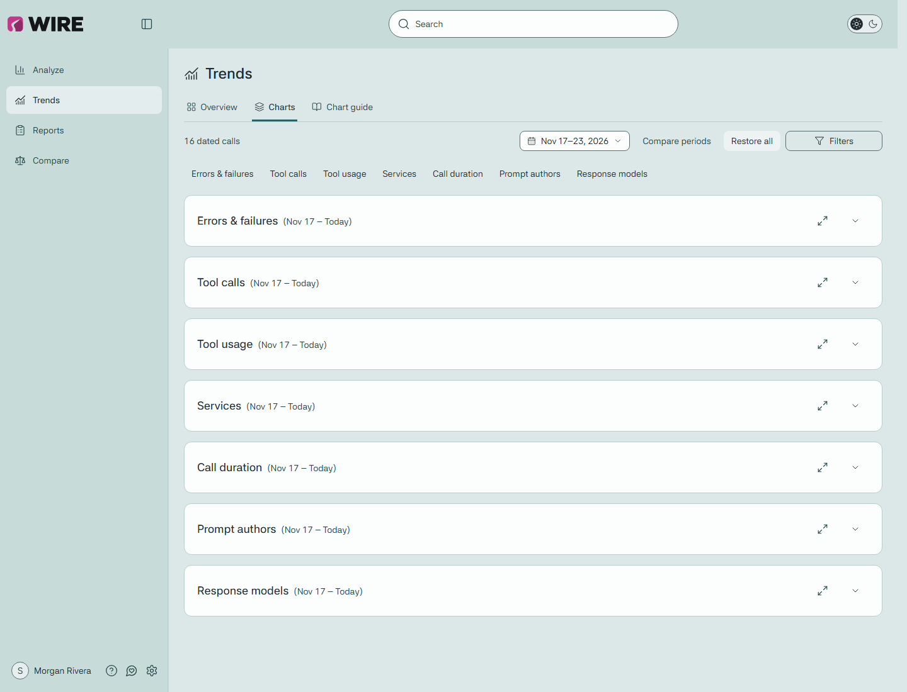
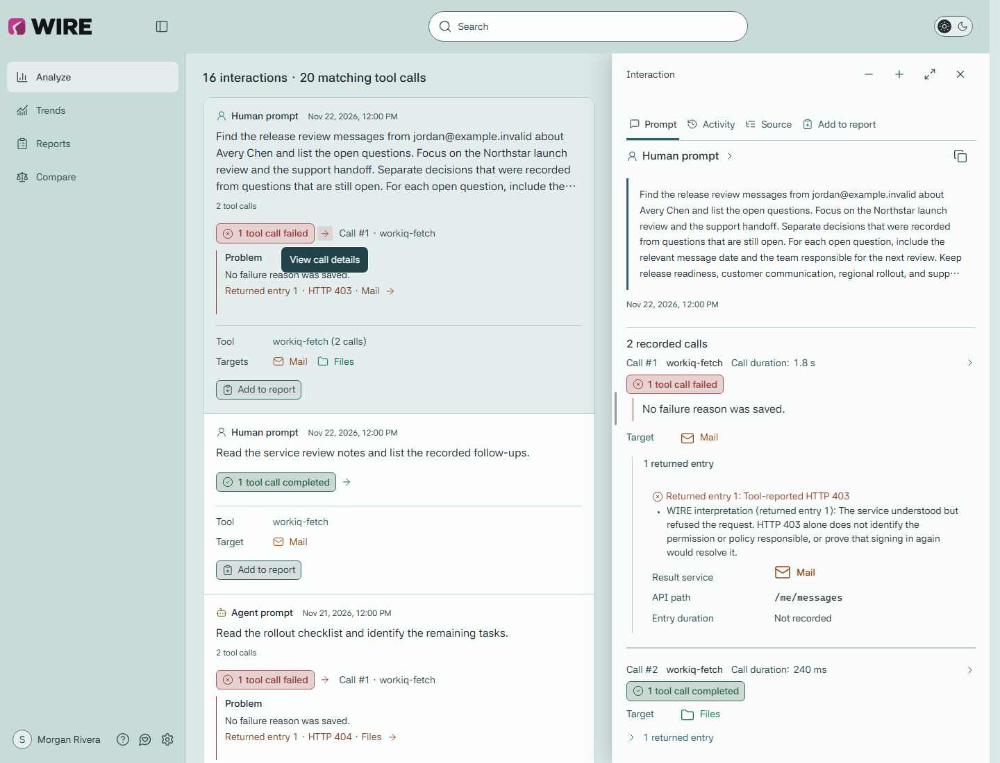
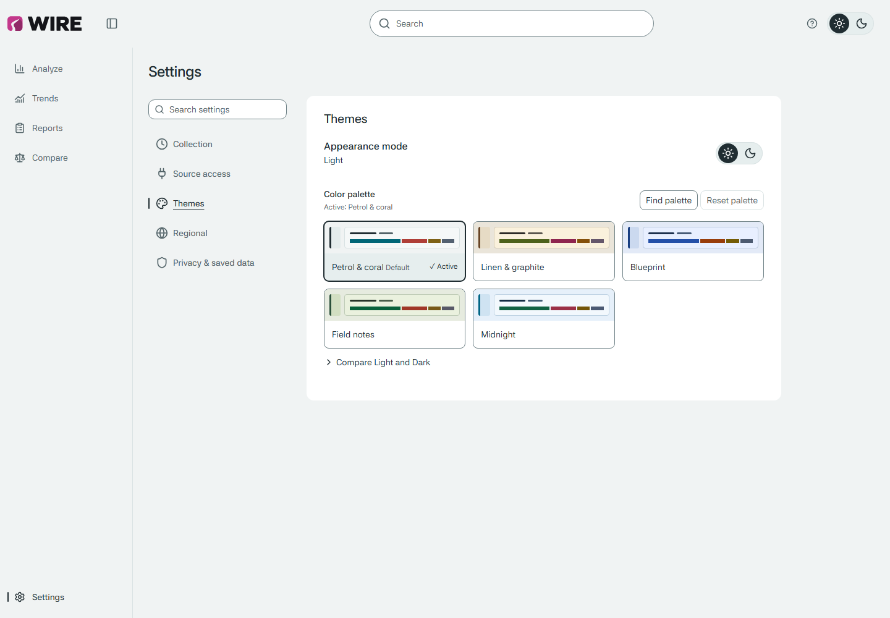

# Use WIRE

Use WIRE to inspect recorded Work IQ activity, find saved text and prepare
reports from your local GitHub Copilot app history.

Follow [setup](../README.md#getting-started) first. For WSL or a second instance beside
Windows, see [platform setup](development.md#windows-wsl-and-linux).

**Analyze is the home page.** Open the address printed by WIRE as-is. Trends,
Reports, Compare and Settings have their own addresses (`/trends`, `/reports`,
`/compare` and `/settings`). You can bookmark those pages, a Settings category,
or a public date/filter view. Older WIRE links such as `/#trends` still open.

You can copy an ordinary interaction's address or refresh its reader. WIRE
opens the same record only if it is still available in the same local store.
The address does not contain its chat or record ID. Search words, exact calls
and source-specific filters are private. Use **Back** in the same tab to return to them.
If you refresh or copy a private view, WIRE may ask you to reopen its original
record or repeat your Search rather than showing a broader result.

## Connect local history

WIRE prompts you to connect when you first open an unconfigured instance.

1. Choose **Review and connect** in the welcome. **Not now** closes it and leaves
   the connection prompt in Analyze. You can also use **Settings > Source
   access > Review source & connect**.
2. Check **Copilot metadata database** and **Chat history folder**. These must
   point to the supported local Copilot installation whose history you want to read.
   Choose **Change paths** if either location is wrong.
3. Choose **History to include** and **Check frequency**, then select
   **Approve source and start collection**.
4. Choose **View activity** to open Analyze. The first read may take a few
   minutes; activity appears as it is saved. If expected calls are missing,
   open **Collection status** to see known history gaps.

The welcome stays dismissed in this browser at this WIRE address. Dismissing it
does not connect a source. Configured instances open normally, and Pause stays
paused. A missing source or failed read shows its own explanation instead of
asking you to keep waiting.

If Settings says the source settings were not saved, correct the paths or
restore local access and approve again. If it says the change is **unconfirmed**,
read the current connection first; do not repeat the write.

Repeat source approval in each independent instance. They keep separate
collection progress, settings, consent and saved reports. Collection can be on
while older history is still catching up; **Collection status** shows pending,
blocked, missing or bounded history rather than guaranteeing complete coverage.

Approval lets WIRE read that local history; it does not rerun prompts or make
new Work IQ requests. Microsoft 365 Chat and Cowork are not supported connections
in this release. Saving Copilot reply text is a separate choice under
**Settings > Privacy & saved data > Recorded replies** and starts off.

## Read the overview

**Analyze** shows recorded outcomes, activity over time, tools, services and
available response-model names, plus prompt authors. The interaction list below
follows the same filters. Open **Filters** to narrow the view by Dates, Tool, Service involved,
Outcome or Prompt author; **More filters** holds the additional choices.
To read one conversation, open **Filters**, expand **More filters** if needed,
and choose **Chat**. Type part of its title in a long list, then choose the
row. Typing narrows the choices; Escape leaves the selection alone. A chat is
a conversation recorded by the Copilot app. A WIRE sign-in session controls
access to this local instance. Choosing a chat does not switch accounts,
sign out or read new history.

Open **Filters** to check how much history WIRE has checked. A routine partial
check stays there while results are available. An empty result can explain
what history was checked; an actual read error still appears with the results.
Find the prompt in the list, then open its row to see the tools, services and
results in the right-hand reader. A note such as **1 tool call failed** or
**Reported result issue** helps identify exceptions. These are different:
a completed tool call can return an error for an individual item.

An interaction groups a prompt with its recorded calls. One interaction can
contain several calls, and one call can involve several services. Service
shares can therefore overlap. Tool completion means the source recorded
completion, not that the answer was correct. Returned API entries, Graph call
sites and HTTP recorder captures have their own units; do not add them to
tool-call totals. Missing model names mean no name was recorded, not zero usage.
Breakdown rows show percentage first, with the count in parentheses. Model
percentages use all matching interactions, including those without model names;
an interaction with several recorded models counts under each.

**Prompt authors** counts each originating interaction once across all matching
pages: **Human prompts**, **Agent prompts**, or **Author unverified**. The three
counts add up to the matching interaction total. Calls and follow-ups do not add
prompts. Select **Author unverified** in the chart to inspect those interactions.
Unverified authors stay
in the denominator; missing prompt text alone does not make its author unknown.
In the reader, **Source** distinguishes a direct link to the prompt from
grouping by message order. Seeing a skill or system message before a call
doesn't tell you who asked for the work.

On an Analyze card, **2 tool calls failed** opens both failed calls. The
**Problem** area names the affected calls and shows what went wrong. If no
reason was saved, the card says so.
**Returned entry 2 · HTTP 400** opens that particular result, not the first
error or another entry with the same status. Open the reader for the full retained
wording, code and status. A completed tool can still return an error. A missing
completion does not establish that anyone cancelled the call.

In Analyze Filters, Trends, Reports and Compare, open **Dates** to choose a preset.
Choose **Custom dates** to edit below the presets. **Apply dates** uses your range;
**Cancel** keeps the previous one. In Compare, select a period's date label to
edit just that period. Dates filter retained activity; they do not approve older source reads.
Custom dates include both days in the time zone chosen under
**Settings > Regional > Time zone**. Select a start and end on the calendar,
or type them. Today is the latest date you can use. **This week** and **This
month** also end today. Missing history and records without qualified
times remain explicit. No matches means
no matching retained evidence, not proof that no activity occurred.

Author and Outcome choices remain a draft until **Apply**. **Reset filters**
clears browsing restrictions, not collected activity or report selections.
Under **Analyze**, choose **Results** to inspect activity or **Guide** to read
about recorded outcomes. The underline marks the current section. **Refresh**
and **Filters** apply to Results and stay out of the Guide.
Pick another topic beside the explanation, or use **Topics** on a narrow
screen. Worked examples illustrate distinctions such as a completed call
returning an error for one item; they are not records from your activity.
Choose **See exact numbers** for values in your current scope and matching
records where available. Choose **Results** or use browser Back to return to
the same filtered results and reading position. In
**Settings > Analyze > Open Guide to**, you can choose recorded outcomes (default)
or the last topic read in this tab. This preference does not change the charts.

Hover or focus a chart row for its meaning. Select a model or author to see
matching interactions. Select an outcome or a segment of a dated bar for
that result; the number above the bar includes all results for the interval.
A zero opens the chart definition instead of a list of records.

In **Services and operations**, **Search endpoint** means the recorded path
identifies a search endpoint. **Search requested** means the tool requested
a search without naming a target app. **Business app not named** means the
recorded path was `/businessapps/me`; WIRE cannot identify the app. Each row
opens its matching records. A call with several targets can appear in more
than one row.
On an interaction card, an operation or service detail with a right arrow
opens the matching call. **API discovery**, for example, opens the call that
looked for available paths, not a later call that fetched data. Without a
matching retained call, the label has no link. **Exchange ID conversion** identifies a request to
convert item IDs; it does not identify the mailbox item. If several calls match,
the link says **first of N calls**.
The **tool-call count** opens the whole interaction. Expand a numbered call
to see which target and result belong to that call.
To inspect a path, use **Guide > Paths and operations > See exact numbers**,
select the path or batch, and open the matching prompt. Read the targets and
outcome on the individual call rather than inferring them from the interaction summary.

The **Work IQ tool calls over time** chart shows individual calendar days by
default, even with All dates or a long range. Long timelines show up to 90
intervals at a time, starting with the latest dates. Scroll within that window,
or use **Earlier dates**, **Later dates**, **First dates** and **Latest dates**
to reach the rest. The window names its dates; totals and filters still cover
the whole selected period. Paging does not change which interactions a report includes.
If an old link points outside the current dated activity, **First dates** or
**Latest dates** returns to its recorded dates without clearing your filters.
**Guide > Activity over time > See exact numbers** has the window's exact
daily rows and the full selected-period dated total.
A zero is no qualifying retained calls that day, not proof that no
activity occurred. Undated calls stay outside the timeline. Existing links
that explicitly request weekly or monthly grouping keep that interval when dates
change. Compare's separate Day/Week/Month control does not change Analyze.

## Trends

Choose **Trends** in the sidebar. By default, **Overview** shows how many
interactions had a recorded error or failure each day. A cross at zero means no matching
dated calls; a circle at zero means there was activity but no recorded error.
**Charts** lists the seven measures. **Chart guide** explains their units.
On Analyze,
choose **View trend** on a widget to open its corresponding measure. From
**Tool call results**, WIRE asks before showing **Errors & failures**: that
chart counts affected interactions, not call outcomes. **Back to Analyze**
restores the original widget.

### Choose the period and activity

Open **Dates** for **Last 7 days**, **Last 14 days**, **Last 30 days** or
**Custom dates**. With no period selected, Trends starts with the last seven
days. If that week is empty and older dated calls exist, **Latest activity**
shows the seven days ending on the most recent matching call. An explicit
period or Analyze widget never moves automatically. An empty period can offer
**Show week ending …** without dropping the active filters.

The period control shows the accepted dates while a new read is pending.
An explicit preset, measure or user-entered custom range can be reopened
from the address; private filtered selections stay in the original tab.
If WIRE cannot restore a private selection, reopen the result from its original
tab. To continue without that selection, choose **Open this view without the
private selection**. Neither action deletes saved activity.
Every civil day is available in **Data table**. Long single-series charts
space out date labels to show more of the period at once. If the chart
scrolls, the dates in view are shown below it; the index initially shows
the span with the most calls. Custom ranges over 90 days page through
days without changing full-period totals. The table caption identifies the daily
rows shown. Use **Earlier days** or **Later days** to change pages; at either
end, keyboard focus moves to the direction still available. Dates use the display time zone and
include both endpoints; choosing older dates does not collect older history.

**Filters** changes the activity included, even while a chart is maximized.
Apply author, tool and service choices together; Cancel leaves the scope alone,
and **Clear filters** restores the unrestricted period. The series checkboxes only
show or hide series; they do not recalculate percentage denominators.

### Read the measures

Period breakdowns summarize the whole chosen range. A dated point uses that
day's matching population. **Count / Percentage** changes compatible measures;
tool percentages can use calls or originating interactions. Duration remains
in milliseconds. **Columns / Lines** changes the drawing, not the values.
**Compare measures** lets you choose two readings for the same dates, or start
from an example on Overview. For example, compare **Errors & failures ·
interaction share** with a tool's **interaction reach**. Both count matching
interactions that day, so they can share one graph. Call share uses a different
denominator; call volume and duration use different units. These use aligned charts.
Aligned charts share a vertical scale when their units and denominators match.
**Share within week** marks each week boundary; its line stops there because the
next point uses a different denominator. Select a date to see that week's selected dates.

Select a point for its exact daily reading and matching calls. **Remove
comparison** drops the second measure; **Collapse chart** keeps your choices.
**Daily values** includes both measures on the current date page. The optional
correlation describes that page's paired daily values, not causation or
individual calls. **Compare periods** instead compares this period with the
preceding period of equal length. Review the dates and scope before opening
Compare; **Back to Trends** returns to the pair and selected day.
On grouped columns, one zero under a date means all **shown** series are zero.
Unavailable measurements use a dash instead. On an individual chart, **Data table** includes daily numbers and period
totals, including series hidden in the chart.

| Chart | Measure |
| --- | --- |
| Tool usage | **Interactions %** shows the share of matching interactions that used a tool at least once (its reach). **Calls %** shows the tool's share of matching calls; **Calls** shows the count. Several tools can reach the same interaction. |
| Prompt authors | Matching originating interactions, split into Human prompts, Agent prompts and Author unverified. Unverified authors stay in the denominator. |
| Tool calls | Matching tool calls per day. **Share within week** uses the matching calls in that calendar week within the selected dates. Point context names that week and denominator; a short rule along the date axis marks partial weeks. |
| Services | Matching calls involving each service, as a share of all matching calls. One call can involve several services, so shares can overlap. Missing service detail and preparation calls remain separate. |
| Errors & failures | Matching interactions with a failed call or recorded application/API error, as a share of all matching interactions. Unknown call outcomes are separate; a tool can complete while its result contains an error. |
| Response models | Matching interactions with each recorded model, as a share of all matching interactions. Multiple models can overlap, and interactions without a model name stay in the denominator. |
| Call duration | Recorded tool-call intervals in milliseconds, summarized as Median and 95th percentile. The coverage note identifies how many matching calls have qualified timing. |

Prompt authors counts interactions with activity that day, not every message
sent in Copilot. One interaction can appear on several days but counts once in
the whole period. Call duration shows Median and 95th percentile together; its
header buttons are shortcuts for the same series checkboxes. Hiding either
series leaves the timing sample and coverage unchanged. Missing or partial
history, undated calls and unavailable measurements remain distinct from zero.
Collection status covers source-wide read/import problems; those do not establish
which dates are affected. Limits specific to the chart remain beside its values.

### Inspect a change

Hover or focus a dated mark to read its values. Arrow keys move between dates
and series. Select a point, then choose the action showing its matching call
count. There is no need to maximize first. Selection
keeps the chart in place; maximizing retains the selected point. Other series'
calls are not added to this list.
Hover a legend entry to emphasize its line without filtering the activity.

Open a call to read its result and full parent interaction. That parent context
can contain calls outside the chart selection. Closing the reader returns focus
to the supporting-calls action; reopening the list returns to the call you were inspecting.
Changing the scope retires that return position. Hiding the selected series does
not change its evidence. The list's title and Close stay available while it scrolls.

Choose **Data table** below the chart. On a narrow screen, scroll within
the table; keyboard users can focus it
and use the arrow keys. Dates and column headers stay attached to the values.

For the full-width stack choose **Arrange charts → All charts**. In that
workspace, **Back to overview** returns to the same place. Collapse or restore charts
without losing their measure, series choices or horizontal reading position.
Collapsed widgets show their names and applied dates. Click anywhere on a collapsed row to
open it, or the open widget's header to close it. The arrow button does the same
with Enter or Space; the other controls keep their own actions.

These are retained Work IQ patterns, not a census of Copilot prompts,
answer-quality judgments, productivity scores or evidence of causation.
For a two-period comparison or a saved copy, use
[Compare](#compare) or [Reports](reporting.md).

## Compare

Choose **Compare** in the sidebar to compare two periods. To compare two
measures over *one* period, stay in Trends. See [Compare two periods](reporting.md#compare)
for baseline and selected dates, missing values, and the calls behind a change.

## Inspect an interaction

The count above the cards follows your filters. **Collection status** shows
the contributing chats, projects and source coverage. An actual coverage
warning stays beside the affected activity.

Analyze cards show a short preview. Open the prompt to read and copy the
retained original, including text after the ellipsis. The panel icon beside the tool count opens the
recorded activity in the right-hand reader. **Human prompt**, **Agent prompt** or
**Author unverified** describes the prompt’s origin, not its app. A label such
as **1 tool call failed** opens the failed call; it does not mean the whole
request failed. **4 tool calls completed** opens those four calls. If filters
exclude other calls, they stay out of that list. A completed call can still
contain a returned API error. Repeated tools show a count with its unit. Tools, requested targets and operations
are separate; a search or Copilot request does not confirm which apps were used.
When a tool fails and another call returns an issue, use their separate links.
Long prompts start with a six-line preview so recorded activity stays close.
Use the chevron beside the prompt author to expand or collapse the text in place.
**Copy prompt** still copies the whole retained prompt. Search opens the full
prompt rather than hiding a match behind the preview.
Use **Prompt**, **Activity** or **Source** at the top of the interaction to jump
to that section. **Reply** appears when the selected interaction has a recorded reply.
Each call shows its own outcome, such as **1 tool call completed**, even if
one returned entry reported an error. **Call duration** measures the whole call.
Returned entries stay in order and carry their own statuses and timing. If an
error message is shortened, **Full diagnostic** opens its saved wording.
Open the call for its exact input; **Source details** holds provenance and
identifiers. Close or Back returns to the originating results.

**WIRE interpretation** explains a recorded condition or evidence gap separately
from the source diagnostic. It uses fixed local rules, without AI or provider
calls, and explains what the evidence establishes without suggesting fixes or
next steps. A clear source explanation needs no additional interpretation.

Drag the reader's left edge or use its minus/plus buttons to narrow or widen
it. **Maximize interaction** fills the workspace below the toolbar;
**Restore reader width** returns to your chosen width while keeping your place.
**Close interaction** leaves the reader instead. When space is limited, WIRE
uses a single-pane reader and hides the sizing controls.

**Human prompt**, **Agent prompt** and **Author unverified** describe supported
origin evidence, not who executed or authorized every call. Choosing Human and
Agent is not the same as All, which also includes unverified authors.
The reader explains retained origin gaps separately from call results. For
example, WIRE may not recognize the host's message format even when the prompt
text and tool result were saved. Older records may lack that specific reason.

A file attachment may appear as a label such as `notes.md` rather than its
contents. WIRE keeps the text recorded in Copilot; it does not open the attachment
or add its local path.

**Tool latency** is the recorded call interval. **Prompt to final response**
measures from the originating message to its recorded final response when
that link is available. Concurrent calls are not added into a task duration.
Missing timing is not zero.

Copy controls copy the exact retained original, unmasked. A saved Copilot reply
is the assistant's text, not a tool result. Enabling reply saving does not
restore previously omitted replies.

Use **Add to report** at the bottom left of a card, or the same action after
**Source** in its reader. Choose a draft to add the entire interaction without
leaving Analyze. Reopen the picker to add it to another draft or remove it from
one. See [Keep interactions in a draft](reporting.md#keep-interactions-in-a-draft)
to prepare, save or delete that selection.

## Make a report

In **Reports**, select a named draft or start a **New report**. Check its
activity, dates, text and formats, then choose **Prepare preview**. Nothing
has been written. Read the finding and its examples before choosing **Save
report**. Open an existing report by name in **Saved library**.

[Create and read reports](reporting.md) covers scope, text masking, file
inspection, and what happens when you delete a draft or a saved copy.

## Find saved text

Type in the stationary **Search** field. Results appear as you type; there is
no Submit step. `POWER` and `owerp` both find `PowerPoint`. A phrase matches
that literal sequence, not scattered words, inferred intent or synonyms.

**Everywhere** searches authorized retained content and navigation destinations
across pages. **Current Analyze scope** deliberately narrows the analytical
population and current-view report membership. Selected interactions and All
collected activity report scopes remain separate. Availability notices identify
content Search cannot include.

Open a result to inspect its exact verified destination. Back restores the
Search context while it remains authorized. Missing, changed or unreadable
content is not silently replaced with a nearby result. Search runs locally,
without AI, providers, new collection or credit spending. Its query is not
placed in URLs or saved as a persistent Search index.

## Find a setting

Open **Settings** at the bottom of the left sidebar and type in **Search
settings**. Matching destinations appear under their categories.
Settings opens in **General**. **Check for updates** checks WIRE itself, not
your Copilot history. On [supported installations](development.md#updating-wire),
you can check with automatic checks off. If General says **Updates are managed
manually**, use this installation's usual update process instead.

Below updates, **Current theme** shows your palette name, Light or Dark mode,
and a preview with its colors.
Select **Change theme** to open **Themes**, or select **Time zone** to open
**Regional**. **Back to General** returns to the shortcut with your current choice.

Under **WIRE defaults**, choose how views open and new reports and comparisons start in this browser:

| Category | What you can change |
| --- | --- |
| Analyze | Open on All dates or the last 7, 14 or 30 days, including today. This filters saved activity. Guide can open to Recorded outcomes or the last topic you read in this tab. |
| Trends | Choose the default trend chart. A link to a specific measure still opens that chart. |
| Reports | Preselect HTML, PDF, Markdown or JSON (at least one), and the last 7, 14 or 30 days including today. These choices start a fresh draft; they do not prepare or save files. |
| Compare | Start with the last 7, 14 or 30 complete days, ending yesterday, versus the preceding period of the same length. A comparison from Trends keeps its chosen dates. |

Defaults do not rewrite a view you return to, an existing draft, or a saved
report. If the browser cannot save a preference, Settings tells you that the
choice applies only to the current panel.

Search includes setting descriptions and keywords:
`record` finds reply saving, deletion, rereading history and the network
diagnostic; `city` finds Time zone.

Select a result, or use Tab and Enter, to reveal and focus the existing setting.
Its help and consequences stay beside that control. Selecting a result never
changes a setting, deletes activity or starts collection or a diagnostic.
Unavailable actions remain findable, with their explanation at the destination.
Clear the field or press Escape to return to the categories. Browser Back
returns to the query and link you came from.

This search runs on-device over fixed setting information. It is separate from
the main Search field for saved activity and reports, and does not read private
path values.

In **Themes**, choose Light or Dark and one of five color palettes for this browser.
Change the time zone separately in **Regional**. The toolbar switch changes only Light/Dark. Select a palette card to
change the screen immediately; **Compare Light and Dark** shows the selected
palette in both modes. **Reset palette** restores Petrol & coral without
changing mode. If storage is unavailable, the choice applies to this panel
only. Changing appearance does not rewrite saved reports or their original time zone.

## Keep collection and saved data separate

**Settings > Source access** shows which paths WIRE can read. **Collection**
sets the history window, check frequency and Pause. Edit the values to show
**Save preferences** and **Cancel changes**. **Refresh** checks approved local history;
**Read stored activity** only rereads WIRE's retained view. Paused collection
stays paused after a deliberate local-history check. **Collection status**
explains missing files, bounded reads and other known coverage gaps.

If **Collection cannot check history** appears, open **Collection status** for
the failing operation and reason. Retained activity stays available.

Collector updates improve supported reads; they do not automatically repair
older retained activity or rewrite saved reports.

**Account > Sign out of this instance** stops collection and hides saved private
activity in every tab of that WIRE instance, without deleting it. It does not
sign out of GitHub, the Copilot app or another independent WIRE instance.
Open **Account** at the bottom of the navigation (inside the navigation drawer
on small screens). WIRE reads the GitHub name and avatar from the approved Copilot app
source: the recorded workspace's linked account, otherwise the app's GitHub
default. This display profile does not control access to history. A neutral
icon means the profile is unavailable, not that collection needs a different
GitHub CLI login.

Drag the sidebar's right edge to resize it. With the divider focused, use the
left and right arrow keys. WIRE remembers your width in this browser;
double-click the edge or press Enter on it to restore the default.

Open **? (Help)** at the bottom of the sidebar for **Prepare a report**,
**Find missing activity**, **Understand activity counts**, or **Read tool results**.
Select a topic to read its answer. Your browser’s Back and Forward buttons
revisit topics and earlier pages. Chart definitions and examples stay in the Analyze and Trends guides.

In Collection status, **HTTP recorder** shows any saved diagnostic. Normal WIRE
launches cannot start a new network test. A saved diagnostic is separate from
Copilot collection status.

Use **Feedback** beside Help to report a WIRE bug or suggest a feature.
Enter a title and, optionally, a description. **Open on GitHub** fills in
those fields on WIRE's new issue form. The issue is public only after you submit it.

In **Privacy & saved data**, **Review deletion** previews an exact activity
scope before separate confirmation. **Read history again > Choose chats**
is a different, deliberate reread of selected approved history; restoring
deleted original prompts is an independent choice. Neither filter reset nor
ordinary Refresh performs these actions. Saved reports and external downloads
can retain copies after activity deletion.

If a change's result is uncertain, use its offered status/result check rather
than repeating the action. The [collection and recovery reference](collection.md)
explains each operation's effects and limits.
